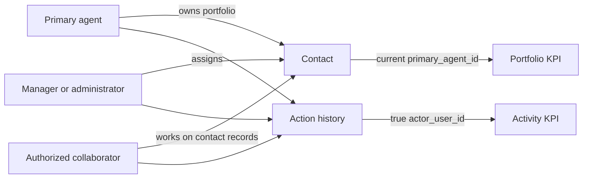
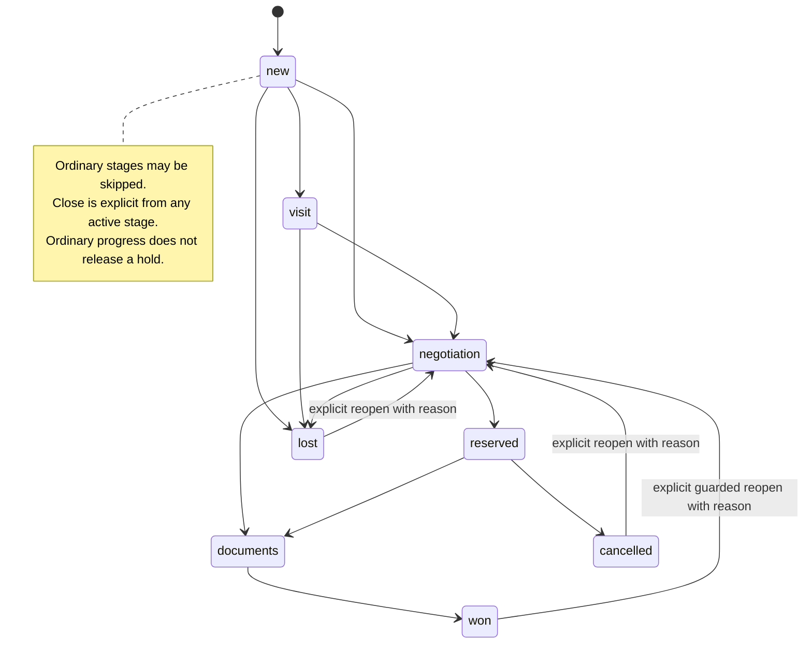
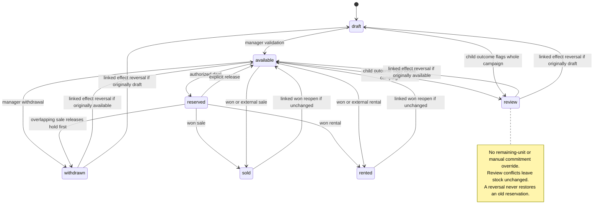

# Business rules

Status: reference specification, not implemented  
Date: 2026-10-14  
Confirmed decisions: BR-01 through BR-31, except where an assumption or proposed conflict-resolution policy is explicitly identified.  
Technical proposals: state codes and concurrency controls in the design documents.  
References: [scope](../../core-scope.md), [decisions](../../decisions.md), [permissions](../../permissions.md), [data model](../04-design/data-model.md), and [tests](../05-quality/acceptance-tests.md).

Every BR has expected evidence in the [traceability matrix](../05-quality/traceability.md). A user's confirmation is a recorded act; it does not grant an otherwise forbidden role permission.

| ID | C | Confirmed rule |
|---|---|---|
| BR-01 | C01,C14 | One KAY team. The first administrator is created once by a script run locally on the deployed server by the intended administrator; later named accounts are created manually by an administrator. Roles are `administrator`, `manager`, and `agent`; administrators inherit managers' business rights. Passwords have at least 12 characters. No MFA, SMTP, email verification, or public sign-up. Q-04's proposed in-person initial-credential policy is detailed in the bootstrap runbook. |
| BR-02 | C01,C14 | A session lasts at most seven days, can be revoked, and checks current permissions. Resetting another user's password requires the administrator's own current password and revokes the target's sessions. |
| BR-03 | C02 | Name and phone are required. Multiple phones and emails are allowed, with one primary value for each non-empty collection. Valid international calling codes are accepted; the normalized canonical phone identifies the contact. |
| BR-04 | C02 | A phone belonging to an accessible contact triggers an explained warning and an explicit choice to reuse or merge within authorized scope. Name alone never merges contacts. An agent encountering another agent's private contact cannot create a duplicate; they see only the primary agent's name and request access or transfer. |
| BR-05 | C02,C05,C10 | Each contact has a primary agent and may have collaborators. They work on the accessible CRM records for that contact; each action records its true actor. Transfers preserve the former agent, new agent, actor, and history. |
| BR-06 | C02,C04,C08 | Managers have full business access; administrators also manage accounts. Agents work on contacts they own or collaborate on. All staff read developments, blocks, floors, unit types, physical units, offerings, and shared inventory attachments; only managers/administrators edit inventory directly. Private owner/developer contact details and documents stay on protected contact records. |
| BR-07 | C03 | A contact may have several independent requirements. Required criteria and preferences are separate. Unknown differs from zero or false. Manual shortlist entries link to the correct property offering. |
| BR-08 | C03,C04 | For monthly rent, annual equivalent = amount × 12; for yearly rent, annual equivalent = amount. Compare on that exact basis and retain the original price, period, and conditions. MAD only. |
| BR-09 | C04,C08 | One physical `property` or whole `development` has at most one current offering of each `sale` and `rental` type. Each offering has at most one active reservation, with no automatic expiry. Project/unit overlap is also checked under BR-27/28. Competing deals are flagged for review. |
| BR-10 | C04,C08 | A completed sale marks the target's sale offering `sold`, withdraws its unfinished active rental offering, and releases its reservations; completed rental history remains. A completed rental marks the target's rental offering `rented`; sale may remain active while clearly showing occupancy. Other deals are not closed automatically. For a whole-development target, BR-27/28 add child-unit conflict and propagation checks. |
| BR-11 | C04,C08 | A manager may mark a physical property or whole development sold or rented elsewhere, subject to the same project/unit overlap checks. This changes stock and flags affected deals without inventing a KAY win or commission. |
| BR-12 | C08 | The initial fixed pipeline is `new`, `visit`, `negotiation`, `reserved`, `documents`, `won`, plus `lost` and `cancelled`. Stages may be skipped. Closing requires the actual agreed amount, date, and explanation; accepting a customer offer is insufficient. |
| BR-13 | C04,C08,C09 | A contact's primary agent or collaborator may reserve, close, and reopen their deal, whether it targets a physical unit or whole development. Reopening preserves the previous outcome and restores stock only if its current project/unit state permits. A collision goes to manager review. No collection or earned commission is erased automatically. |
| BR-14 | C09 | Commission is optional for every deal. It is fixed or proportional to an explicit base. Only managers/administrators read or change recognition, due dates, collections, and corrections. |
| BR-15 | C09 | Recognition and every collection are confirmed separately. Partial collection is allowed; an amount above the remaining balance is rejected. A correction retains the original, its reason, actor, and any replacement. |
| BR-16 | C06,C07 | An appointment conflict produces a warning; an authorized user may confirm with a reason. Colleagues see only free/busy, never title, contact, address, or details. An empty slot means only that no CRM appointment is recorded. |
| BR-17 | C06,C07 | Internal visit reminders occur one day and one hour before; task due notifications and overdue lists are provided. Rescheduling, cancellation, or completion invalidates stale reminders. No external message is sent. |
| BR-18 | C10 | Portfolio is attributed to the current primary agent; outcomes to the primary agent at closing; activity to the true contributor. Period and access rules apply to both totals and drill-downs. |
| BR-19 | C10 | An available physical property or whole-development offering without reconfirmation for 30 days triggers an alert; an active deal without relevant activity for 14 days triggers an alert. Alerts do not automatically withdraw or lose records. |
| BR-20 | C11 | Managers/administrators import contact CSV files, with an active agent identified per row or an explicitly chosen fallback. An existing phone causes the entire row to be skipped and reported. Invalid rows must be corrected before approval. Eligible new rows are created in one atomic transaction. |
| BR-21 | C11,C12 | Lists have numbered pages, Next/Previous, and stable ordering. A connector contract is defined for one existing website form; the actual site remains to be identified. Retrying the same submission creates one enquiry; a new enquiry from the same phone uses the same contact. |
| BR-22 | C13 | The product interface remains in French and responsive on desktop and phone, with truthful loading, empty, error, conflict, denial, and success states. Keyboard, touch, and zoom are covered. |
| BR-23 | C14 | Contacts have no automatic expiry and can be archived reversibly. Security audit records are retained for two years. Transactions and financial evidence remain protected under a separate policy KAY must confirm before any purge. |
| BR-24 | C14 | Consistent database/file backups are kept for 30 days; target RPO is one hour and target RTO is four hours. Restore exercises are required before release approval. |
| BR-25 | C02,C04 | `villa`, `house`, `apartment`, and `land` are physical property categories, each allowed as a standalone asset or a unit in a development and independently marketable for sale and rent. A developer and an ordinary individual client are contacts, not new staff roles. A development may mix categories. |
| BR-26 | C04 | A development groups physical units. An apartment unit in a development belongs to a floor in a block; one block is sufficient and more are allowed. A marketable apartment development has at least one block, floor, and actual apartment unit; incomplete drafts may be saved. Block/floor are optional for non-apartment units. A unit type is a reusable development-scoped template, possibly shared across floors; each actual unit is a separate physical asset with its own identity, offerings, availability, and reservations. |
| BR-27 | C04,C08 | A whole development and its units may each have sale and rental offerings. An offering identifies one target level; it never represents a unit type or a floor. Before reservation or closing, inspect affected project and unit commitments. One active reservation per offering remains mandatory, and overlapping same-kind whole-development/unit reservations cannot both become active. |
| BR-28 | C04,C08,C10 | Whole-development and unit outcomes must not silently invalidate one another. A whole-development close with a previously sold or leased child unit cannot claim the entire development without an explicit manager-reviewed scope resolution. A unit sale makes a still-advertised whole-development sale require review; neither deal history nor committed stock is erased. Any project-level stock effect flags affected open deals and preserves actor/history. The precise partial-development commercial policy remains Q-06. |
| BR-29 | C01,C02,C08,C10,C13 | Login opens a role-scoped dashboard. Managers/administrators see agency-wide permitted KPIs and drill-downs; an agent's dashboard shows only work assigned to or shared with them, not agency-wide inventory totals merely because inventory is readable elsewhere. A UI `lead` is an `enquiry` linked to a `contact`; a lead detail must not expose a private contact outside the caller's scope. Lead and deal lists offer search, filters, numbered pages, and configurable visible columns; project lists offer scoped search/filter and numbered pages. Column visibility never changes server authorization. |
| BR-30 | C01,C07 | An administrator controls working days/hours, lunch breaks and company-car hourly capacity in the database. Both off-site types fit working periods and avoid lunch; office visits are allowed at any time. Company-car capacity starts at two agency-wide and is adjustable only by an administrator. The accepted local Q-07 rule counts each hourly interval touched by [start,end), with the exact end excluded and DST offset/UTC intervals distinguished. Policy changes preserve existing visits and report conflicts. |
| BR-31 | C04,C13 | A development may have an optional project briefing visible as shared inventory information. It is never required for draft creation or availability. Managers/administrators may create and edit it; agents read it with other safe development facts. Private developer/owner contact details and documents must not be copied into the shared briefing. |

## Assumptions H-01 through H-03

D29 adopts a known positive target price before availability (H-01), at least one recorded legal owner (H-02), and support for multiple owners (H-03) as accepted local implementation defaults. A developer link alone is not legal ownership; drafts can retain unknown values. Local AT-27 is actionable. Suitability for later real-data use remains a separate validation in [decisions](../../decisions.md) and does not block synthetic local sprints.

## Rules shared by all workflows

Every business write requires current authorization on the record, a current version, and a consistent transaction. Reservations, imports, closing, and financial corrections resist retries and concurrent races. Errors explain the cause without exposing another private record. Retention and international data transfer policies must match their real purposes and be validated before real data is used; see [privacy](../04-design/security-and-privacy.md).

## Responsibility and attribution

This view separates the portfolio owner, collaborators, and the person who actually performs an action. A transfer changes current scope, never a past actor. [Mermaid source](../../diagrams/responsibilities.mmd).

## Deal and stock states

An authorized command may skip intermediate stages. `won` retains an outcome event; reopening creates another event and checks current stock. The diagram shows principal transitions, not permission to directly edit a property offering. [Mermaid source](../../diagrams/deal-states.mmd).

A rental can remain active while a sale offering is open. BR-09 through BR-13 and BR-25 through BR-28 specify the effects of closing an offering and handling whole-development/unit overlap; AT-09 through AT-13 and AT-31 through AT-35 test them.

Each physical-property or whole-development offering has its own state. Restoring a won sale to availability requires reopening the deal and checking the target and any child-unit stock versions; the diagram does not promise an automatic restoration. [Mermaid source](../../diagrams/offering-states.mmd).

