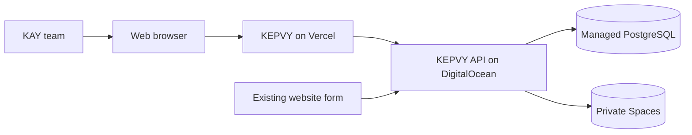
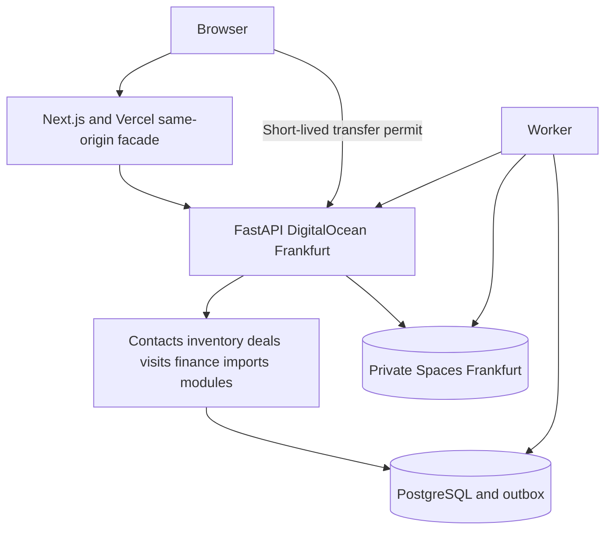
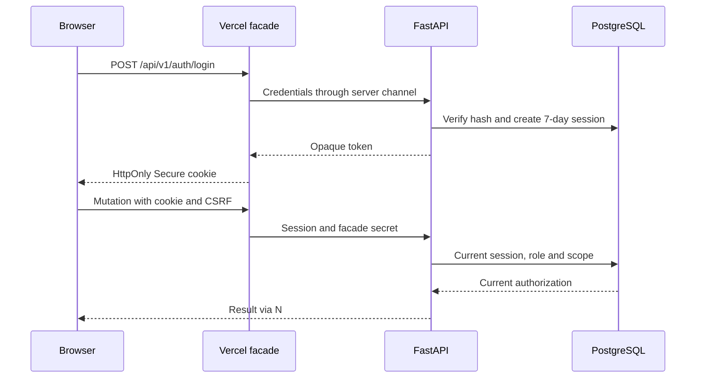
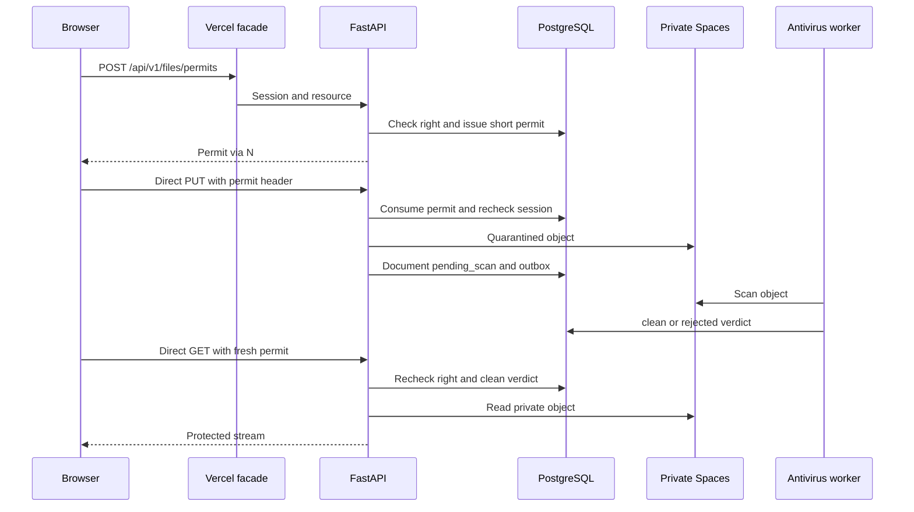

# KEPVY core architecture

The default-off [live update extension](realtime.md) adds one PostgreSQL LISTEN
connection/API process and a bounded post-commit invalidation publisher, not a
connection/socket or a new business-write channel. The browser uses direct WSS
with a one-use facade ticket; revocable PostgreSQL sessions and scoped REST stay
authoritative. Existing PostgreSQL worker dispatches private generic Web Push.

SP-22 exposes the local API CLI's bounded --workers1..4 (default1). Multi-process
mode uses the same app.main:create_app factory under Uvicorn spawn, real current
PostgreSQL sessions and shared maintenance leases; it is not a second application
or a cache. Each process retains its pool5/overflow0/2s SQL budget. The explicit
4-process configuration is evaluated at the full100-user local benchmark; no
production sizing or acceptance is inferred. [Procedure](../06-delivery-and-operations/local-final-acceptance.md).

SP-21 adds app/recovery and the venv-only app.cli.backup utility. Protected
same-account local points combine PostgreSQL 18 dumps, immutable private objects,
code/lock archives and authenticated manifests. API streams, workers and file
maintenance share PostgreSQL admission leases; a write pause drains them before
snapshot or isolated restore. Recovery services stay closed until identity,
compatibility, hashes, current authority and revocation/reconciliation checks
succeed. No public restore route, broker or cloud dependency is added.
[Local contract/runbook](../06-delivery-and-operations/local-backup-recovery.md).

SP-20 adds app/intake, local website_source/website_control/simulator CLIs and
features/intake. The separate venv HTTPS127.0.0.1 form origin signs server-side,
verifies loopback upstream TLS and never proxies staff cookies/APIs. Durable
receipt/outbox precedes202. Existing PostgreSQL worker uses a short atomic
database-only transaction/shared agency lock; no external side effect requires
a lease fence here. Process death rolls back claim and effects together.
[Implemented local contract](website-intake-local.md). No new broker/service
dependency or production connection.

Status: SP-01–SP-21 scoped local boundaries implemented and verified; production infrastructure not deployed
Date: 2026-10-16  
Confirmed decisions: Next.js on Vercel; FastAPI, SQLAlchemy/Alembic, and workers on DigitalOcean Frankfurt; managed PostgreSQL; private Spaces; seven-day sessions; cookie proxy for ordinary calls and direct file transfer with a temporary permit.  
Technical proposals: module boundaries, deployment details, job controls, and telemetry below.  
References: [rules](../02-requirements/business-rules.md), [API](api-contracts.md), [security](security-and-privacy.md), [proposed repository structure](../01-working-agreements/repository-structure.md), [recovery](../06-delivery-and-operations/release-and-recovery.md), KV note `Knowledge/Engineering/Software Architecture Patterns.md`, [Vercel Functions](https://vercel.com/docs/functions/limitations), and [DigitalOcean App Platform](https://docs.digitalocean.com/products/app-platform/).

## Local implementation boundary

SP-18 adds app/imports and features/imports within Leads: protected direct CSV
upload, strict bounded parser, preview/agent snapshot and atomic approval. The
existing agency lock/global phone uniqueness protects ordinary contact writers;
bounded ordered phone buckets and retained SQL batch guards protect approval.
Reconciliation retains referenced raw objects; no public import file URL or new
broker/worker/database. [Concrete contract](contact-import-local.md).

SP-17 adds app/reports as a read-only SQL projection module. Each request owns a
READ ONLY REPEATABLE READ session; count/group/sum/page reuse scope-filtered
rowsets. Frontend features/reports validates projections through the existing
HTTPS facade and composes lazy local Bklit wrappers with numeric tables. No cache,
broker, reporting database, background metric mutation or client-wide aggregation.
See [local reporting](dashboard-local.md).

The approved [22-sprint roadmap](../03-planning/local-roadmap.md) implements the same business modules locally in separate frontend/ and backend/ directories. The backend and every Python tool run through backend/.venv. Local HTTPS frontend/API origins preserve cookie/facade and direct-transfer behavior; the existing PostgreSQL installation has isolated test, benchmark and restore targets. A private filesystem storage adapter and real ClamAV replace cloud storage for local execution. A signed loopback form server exercises website intake; a separate worker uses the shared backend package. No Vercel, DigitalOcean, Spaces or cloud backup is provisioned by these sprints. Provider-specific sections below remain future production design references.

SP-05 locally implements contacts as contracts/access/queries/commands/projections/
router plus reviewed 0004 DDL. It shares current database sessions, CSRF and typed
audit with identity. The Next facade allowlists ten explicit contacts/enquiries
routes; browser code has no database authority. Lists use a consistent snapshot
and batched projections after scope filtering. Contact+enquiry and retry/audit
form one transaction, agency-first serialized for local correctness; later
measured scaling must preserve these invariants. The shared ORM metadata registry
is loaded in CLI and HTTP entry points. The test harness—not the product—holds a
dedicated PostgreSQL advisory lease across either pytest or browser supervisor
lifetime, including API outages, refusing overlapping fixture writers before
cleanup. No broker/worker or file transfer is introduced by this slice.
See [SP-05 evidence](../03-planning/sprints/sp-05-evidence.md).

SP-06 extends that module with typed immutable business history, explicit
ownership/lifecycle contracts, signed impact previews, shared eligibility and one
merge path. Twenty explicit contact/enquiry routes now cross the facade, including
PUT collaborators; no generic relay. Preview holds no transaction while a person
reviews it. Confirmation opens a new agency-first transaction, rechecks actor,
versions and link/eligibility impact, locks contacts in UUID order and active phone
rows, and commits scope, enquiry repairs, history/audit and retry together. Alias
reads authorize the final survivor before returning data. History queries paginate
original events across the survivor's merge lineage, without rewriting actors.
Future contact-link modules must extend the merge policy registry and implementation
before merging is enabled for their links. No worker/broker/notification service
is introduced. [SP-06 evidence](../03-planning/sprints/sp-06-evidence.md) records
current verification and independent product-review status.

## Context

SP-07 adds `app/inventory` (strict contracts, scoped projections, versioned commands,
history and contact-merge adapter), not a new service/broker. Ten explicit inventory
routes cross the existing session/CSRF facade. Reads share a repeatable read-only
snapshot; commands use agency → current actor → physical property locks and typed
retry receipts. Legal-owner identities still require Contacts scope; only explicit
marketing text is shared. The same merge service preserves owner origins and
advances property versions. Revisions0007/0008 add standalone stock/history and
finite numeric checks without speculative hierarchy tables. UI uses Projects'
standalone tab and four contextual property routes. See the
[SP-07 record](../03-planning/sprints/sp-07-evidence.md):150 backend,190 five-browser,
43 unchanged headed cases plus the corrected inventory review,and31 built HTTPS
checks pass. Product review remains pending; later modules are not accepted.

The browser is the core's only staff client. KAY manages its users and an external form submits enquiries; buyers, developers, and property owners have no portal. The diagram shows systems and trust boundaries. [Mermaid source](../../diagrams/context.mmd).

## Components and responsibilities

A modular monolith owns the business rules and one transactional database. Next.js renders the interface and relays ordinary same-origin requests; it is never authoritative for roles or availability. FastAPI authenticates and authorizes users, executes commands, stores canonical state, and writes outbox events. A separate worker handles notifications, file scanning, and connector jobs. [Mermaid source](../../diagrams/components.mmd).

Proposed modules: `identity`, `contacts`, `requirements`, `inventory`, `deals`, `schedule`, `finance`, `imports`, `intake`, `reporting`, `files`, and `audit`. `inventory` owns developments, blocks, floors, reusable unit types, physical properties/units, offerings, and stock transitions; `deals` invokes checked inventory commands rather than editing stock tables directly. In each module, HTTP handlers call an application service, which checks authorization and version before invoking domain rules and SQLAlchemy repositories. Changes spanning several objects use one PostgreSQL transaction. Project/unit reservation and close commands lock the development first, then affected offerings in stable order, and recheck both target levels to avoid races and deadlocks. Dependencies point to internal contracts; the frontend has no direct table access. Reviewed Alembic migrations carry schema changes. The worker uses the same business rules under a service identity and rechecks the originating user's current permissions for deferred privileged commands.

The `schedule` module owns the database-backed agency work policy and all three visit types. Only an administrator may change working days/windows, lunch breaks, or the agency-wide company-car hourly capacity. For each off-site visit the API checks the current policy; an office visit can be booked outside it. Company-car capacity is rechecked under the same policy-row lock used by policy edits and competing bookings, so two simultaneous requests cannot both take the last slot. A free/busy warning remains separate from hard schedule/capacity errors. A policy edit records its actor/version and reports affected future visits for review, without altering their history or cancelling them. Accepted local Q-07 counts each [start,end) clock-hour intersection with DST offset/UTC identity; see [data model](data-model.md) and [API](api-contracts.md).

Jobs and outbox records live in PostgreSQL. The command inserts its effect and event atomically. Workers claim work with `FOR UPDATE SKIP LOCKED`, leases and fencing, bounded retries with backoff, deduplication keys, and a queue of failed jobs for review. A visit reminder key includes `visit_id`, the one-day or one-hour reminder type, and `schedule_version`; that version changes only when time or status changes. Consumer idempotency handles failure after an effect but before acknowledgement. A separate broker is not required for the initial target volume.

## SP-08 local hierarchy

SP-08 extends `app/inventory` with hierarchy contracts/models/rules/commands/
queries/router. Twenty explicit hierarchy routes join the ten inventory routes
through the same facade, staff proof and CSRF boundary. Development mutations use
the existing agency/current-actor lock and typed retry/history transaction;
physical child locks resolve their development first. PostgreSQL0009 adds five
real structure/owner tables and property/development target exclusivity, without
a parallel stock service. Safe numbered level/unit queries batch shared facts,
count each physical unit once and never inherit protected developer/owner scope.
Type defaults never rewrite physical facts. Contacts merge extends its existing
policy/impact/service rather than disabling unknown-module refusal.

UI adds programme list/create/edit/detail and contextual units/hierarchy/type/
briefing/whole-offer tabs. Owner/campaign/history/compare controls reuse the
existing inventory components, including aggregate pending and retry behavior.
No new component/chart kit, dependency, worker, file route or reservation/outcome
engine is introduced. Verification and independent product-review status are in
[SP-08 evidence](../03-planning/sprints/sp-08-evidence.md).

## SP-10 local requirements and selection

The requirements module owns independent contact-linked searches, typed nullable
criteria, precise offering links and24-hour idempotency receipts. It reuses
current staff sessions/contact scope and agency-first serialization with existing
contact/inventory commands. After lock waits it reloads current identity/scope;
no caller-supplied role or cached private response grants access. Reads use one
repeatable read-only snapshot, scope before counts, bounded numbered pages and
batched criteria/shortlist counts. Detail joins real offerings with safe batched
target labels; shared inventory never includes private requirements or feedback.

Exact Decimal/PostgreSQL numeric annual comparisons supplement original MAD
amounts/periods rather than rewriting them. Manual selection changes no inventory
state and performs no automatic scoring/reservation. A versioned shortlist link
names the actual physical/whole-development campaign; templates remain filters
only. Current scope is checked again on receipt replay and after contact merge.
The existing merge preview/service now binds and reparents requirements while
retaining independent IDs, original contact and actors; no collaborator union.

Contact Recherches and Lead detail compose the same French feature. Its strict
server-only facade allowlists requirement GET/POST/PATCH and shortlist POST/DELETE;
binary transfers remain SP-09 and bypass this ordinary JSON relay. Inline RHF/
shadcn forms retain drafts on failure, compare stale versions explicitly, and
reuse exact MAD formatting and target links. No new navigation, broker, chart,
deal/reservation or notification module. Actual verification and remaining
boundaries belong to [SP-10 evidence](../03-planning/sprints/sp-10-evidence.md).

## Session and ordinary requests

The `HttpOnly`, `Secure`, `SameSite=Lax` cookie stays on the actual Vercel-provided address. The Next.js facade relays `/api/v1` calls to FastAPI with session proof and a server-to-server secret. The backend does not trust browser-supplied role or owner IDs. CSRF protection covers cookie-authenticated mutations, and private responses are never cached. FastAPI checks the PostgreSQL session, active user, and record scope on every request. The DigitalOcean address remains reachable for transfers and the website connector, while ordinary staff routes accept only the facade. [Mermaid source](../../diagrams/auth.mmd).

Changing a role, disabling an account, or resetting a password revokes affected sessions. Sessions expire no later than day seven. Tokens are random and stored as hashes. Argon2id hashes passwords; the minimum is 12 characters and passphrases are allowed. There is no SMTP or MFA dependency. The first administrator is created by the one-time server-local script in the [bootstrap runbook](../06-delivery-and-operations/admin-bootstrap.md), not by an HTTP route or migration credential. Subsequent staff receive one-time temporary credentials in person under Q-04's proposed policy and have restricted sessions until they change them. An administrator enters their own password before resetting someone else's.

## Files up to 20 MB

The browser requests a `file_permit` through the facade, limited to one action, session, parent resource, and size. It then sends the file directly to FastAPI at the DigitalOcean address. FastAPI consumes the permit once, rechecks session and permissions, limits size/MIME/signature, places the object in private quarantine, and starts antivirus scanning. A document becomes readable only after a clean verdict. A download uses another short permit and is streamed by FastAPI from Spaces, without a public bucket URL or query-string token. This avoids passing 20 MB bodies through Vercel Functions, whose [documented body limit](https://vercel.com/docs/functions/limitations) is lower. [Mermaid source](../../diagrams/files.mmd).

The direct transfer route accepts only the configured Vercel origin in CORS, with the necessary methods and headers and no third-party cookie. The page passes the permit in a header from transient memory. A download can use `fetch` and present the resulting file to the browser. An interrupted transfer needs a fresh permit; the old one is not silently reused.

The production storage adapter uses the configured private DigitalOcean Spaces bucket for both API publication and worker reads. UUID object keys are prefixed by environment; the filename never forms an object path. Spaces access stays server-side through the same permit route, with SHA-256 checked on each scan/read. Local and isolated environments retain the filesystem adapter. A provider failure records only the operation and a safe error class/code, never credentials, object bytes or private filenames. Existing objects in an ephemeral container are not migrated by changing this adapter; cloud backup/restore remains a separate operational requirement.

Proposed formats are JPEG, PNG, WebP, PDF, and common DOCX/XLSX office files, at most 20 MB each; the final allowlist must be tested with the antivirus tool. Reject contradictory extension/MIME/signature, executable archives, and infected files with explicit error codes. No OCR. Development and physical-property attachments are shared with agents; private owner/developer attachments belong to their protected contact records. A shared project view may aggregate clean unit attachments but does not inherit private contact documents.

## Failures, measurements, and capacity

A conflicting write returns `409 VERSION_CONFLICT` with the authorized current version and non-secret fields; the interface keeps local input until the user resolves it. Project/unit overlap returns a distinct conflict with safe inventory references and a manager-review path where required. Reservation, closing, import, and receipt commits lock rows and recheck invariants. The API reports success only after commit. Notifications and scans are deferred and show a pending state. If Spaces or antivirus fails, the document stays unavailable. If the worker stops, outbox work waits and resumes without duplicate notifications. If PostgreSQL is unavailable, writes fail visibly.

Measure error rates, p50/p95/p99 per route, SQL latency, project/unit lock contention and conflicts, outbox depth/age, scan duration, imports, and restore exercises. Traces and logs carry `request_id`, never cookies, permits, passwords, private content, or full phone numbers. The target to test is 100 accounts and 100 concurrent users, 200,000 contacts, and 20,000 physical properties including development units; vary project sizes and depth in the fixture. p95 ≤ 1 second for ordinary APIs and ≤ 2 seconds for the dashboard. Files, imports, and asynchronous exports have separate measurements. See [release and recovery](../06-delivery-and-operations/release-and-recovery.md).
## SP-09 local file implementation boundary

The metadata facade authorizes typed contact/development/property attachments;
binary PUT/GET goes directly to FastAPI using a short-lived session-bound grant.
No public URL, frontend-public directory, blob service or alternate broker is
introduced. Shared inventory permissions never imply access to private owner or
developer contact evidence. Current contact scope is authoritative even after a
grant was issued, a collaborator was removed, a contact transferred or merged.

`app/files/storage.py` confines UUID-only staging/object paths to
`backend/.local-data/files/{environment}/`, rejecting symlink/reparse ancestors.
Exclusive staging, bounded streaming, structural validation and atomic no-clobber
promotion precede the transactional pending-scan metadata/outbox publication.
A failed publication leaves an unreadable orphan, not a readable file. SHA-256
is checked on every scan/read. Archiving never purges committed evidence.

The separate explicit-venv `app.cli.worker` dispatches PostgreSQL outbox rows
with deduplicated jobs. SKIP LOCKED claims have90-second UUID-fenced leases;
actual ClamAV INSTREAM happens outside the database transaction: loopback locally,
or the explicitly configured private DNS/IP endpoint in production. See the
[production configuration boundary](../06-delivery-and-operations/production-antivirus.md).
Only the still-current lease can publish a verdict and one deduplicated internal
notification. Errors retain quarantine, bounded backoff and at most5 attempts;
expired claims recover after worker restart. An explicit authorized retry resets
an exhausted pending job. No application fake-success scanner exists.

The pinned Docker service has a dedicated persisted signature cache,4GiB memory
limit, no automatic restart and loopback-only3310. Its readiness and real clean/
controlled-test scans are independent gates. The [backend runbook](../../backend/README.md)
describes startup, shutdown and maintenance; [SP-09 evidence](../03-planning/sprints/sp-09-evidence.md)
records actual results, not production acceptance. Notification UI/reminders
remain SP-15; deal attachment support is implemented in SP-11.

SP-11 app.deals shares current-contact authorization, agency/current-user locking
and repeatable-read queries. Deal/proposal/history/receipt mutations are atomic;
private attachments reuse the existing file boundary. See [the local contract](deal-pipeline-local.md)
and [execution evidence](../03-planning/sprints/sp-11-evidence.md).

SP-12 adds the inventory-owned reservation boundary called by explicit deal
commands. Development-first/stable-offering locks, PostgreSQL active-hold indexes
and deferred stock/history guards protect retries and same-kind parent/child
competition. Stock events reuse the existing typed PostgreSQL outbox; the file
worker remains file-scan-only. See [local reservation contract](reservations-local.md)
and [execution record](../03-planning/sprints/sp-12-execution.md).

SP-13 keeps disposition and reversal inside Inventory, invoked atomically by
explicit Deals close/reopen commands or manager-only external-outcome commands.
The existing development-first stock locks and PostgreSQL outbox are reused;
there is no broker, timer, automatic competing-deal closure or financial write.
Complete reviewed stock fingerprints bind optimistic confirmation, not authority.
Safe shared occupancy/effect history remains separate from private deal amounts
and explanations. See [outcomes contract](outcomes-local.md) and
[execution record](../03-planning/sprints/sp-13-execution.md).

## SP-15 durable internal work

The work module extends the existing PostgreSQL outbox/job worker, not a new
broker or FastAPI background task. Commands atomically persist task history,
audit/timeline and typed reminder events. The worker dispatches at most50 rows,
claims one due reminder with SKIP LOCKED, 90-second UUID fencing and at most5
attempts, then rechecks current parent version/status and recipient authority
under agency→job locks. Notification effects commit before acknowledgement;
unique recipient/event keys make crash/replay safe. Rescheduling or terminal
actions invalidate stale events and leases without deleting history.

The same CLI services file work and internal reminders. --once is bounded;
--status returns only aggregate kind/state/count and undispatched counts.
Controlled clocks are internal synthetic-test IPC only. Inbox authorization is
reapplied before counts/pages/links and read mutations. See [SP-15 contract](tasks-reminders-local.md)
and [execution](../03-planning/sprints/sp-15-execution.md).

## SP-16 finance slice

The existing monolith adds app/finance and a narrow Next finance facade, not a
new service, broker or accounting subsystem. Agency/current identity/commission
locks serialize commands, exact numeric SQL guards complement Decimal validation,
and immutable facts/audit/replay receipts commit together. A transactional deal
reopening trigger appends financial review while preserving all existing facts.
Ordinary deal projections remain finance-free; current M/A authorization precedes
private reads/counts and replay. See [the concrete contract](commissions-local.md).
