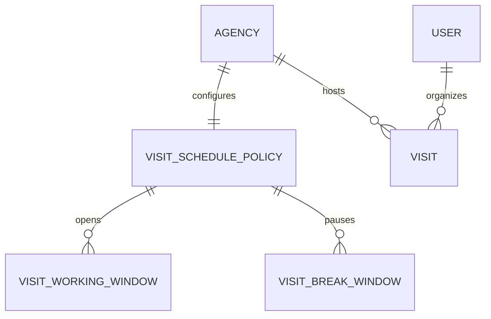
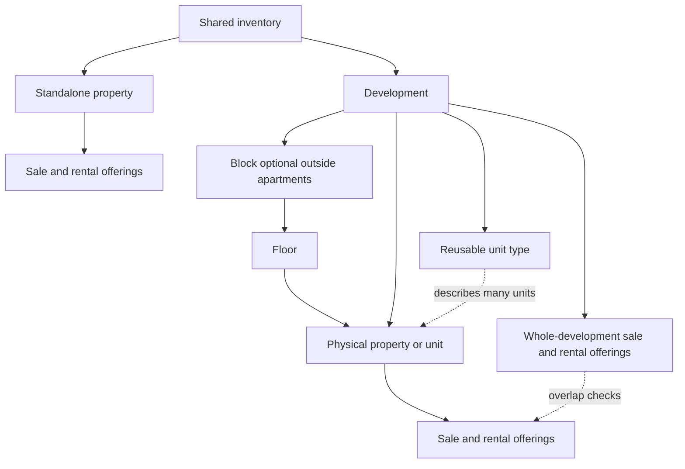
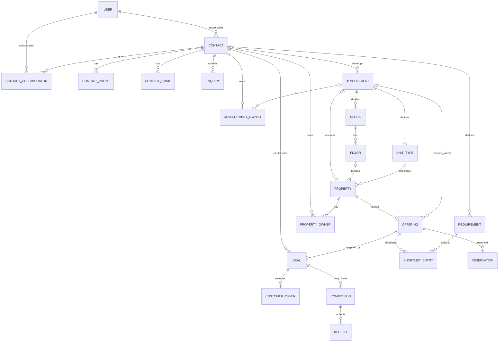
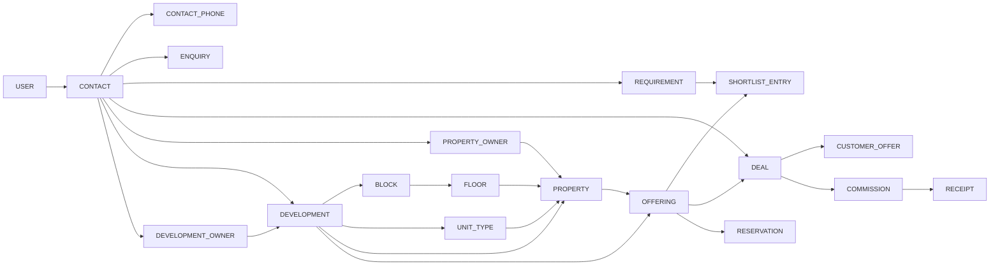

# Data model: dictionary, conceptual, logical, and physical views

## Staff deletion (2026-10-18)

Revision0026 adds nullable `user.deleted_at` and a disabled-state check. No existing
staff, credential, session or CRM fact is rewritten. Identity/email uniqueness
and restrictive author/owner FKs remain. Administration excludes deleted accounts;
auth checks marker/state. No physical purge or restore is added. Isolated
downgrade refuses deletion history; development downgrade is disabled.
[Current evidence](../03-planning/staff-onboarding-deletion.md).

## Record-scoped activities (2026-10-18)

Additive revision `0025_scoped_activities` extends `timeline_event`, rather than
creating duplicate note histories: nullable bounded duration/direction and
`activity_projects` JSONB (default empty bounded string array). Existing rows
receive no invented context, author, date or text. Existing immutable UPDATE/
DELETE protection remains. Lead/time and Deal/time indexes support numbered
history reads. A BEFORE INSERT guard requires exactly one matching parent
contact for contextual manual entries, a nonblank body, and manual context for
the new metadata. System conversion events may retain both explicit IDs.

The existing `enquiry_id`/`deal_id` lineage and contact merge policy preserve
original events after reparenting. New appends use the current parent contact;
reads authorize the current parent before selecting historical context. The
existing receipt and audit tables provide atomic intent replay and true-actor
attribution. No project FK, inventory write, new contact link or broker is added.
Downgrade is isolated-only and refuses any new activity history/metadata rather
than discard it. Local rollout and verification are recorded in the
[activity ledger](../03-planning/lead-deal-activities.md), separately from the
historical qualification rollout notes below.

## Current lead/deal qualification extension (2026-10-17)

Locally validated additive revisions `0023_lead_deal_qualification` and
`0024_deal_qualification_history` extend the existing canonical records; they
do not replace contacts, rewrite original actors, or reserve stock. Contacts
gain bounded ISO-country residence/nationality and language codes. Enquiries
gain budget, campaign source, rating and an explicitly guarded converted-deal
relationship/time. Technical received provenance remains independent of the
editable campaign source.

Deals retain their canonical contact FK and gain qualification, a client-profile
snapshot and ordered `deal_project` interests (one to three for new qualified
deals). Each interest chooses exactly one development, standalone property or
external name. Its position is distinct from any exact inventory offering or
reservation. A case-insensitive external-name index prevents duplicate interests.
Each new deal-history revision captures the complete qualification and ordered
projects; deferred SQL guards compare it to current facts and reject unrecorded
updates. Untouched legacy rows may retain unknown qualification and historical
empty snapshots without invented facts. Populated downgrades refuse retained
business history.

Only the isolated synthetic test database has been upgraded by this task.
Development/production rollout is not authorized or performed. See the
[current wire/workflow contract](deal-pipeline-local.md) and
[migration evidence and acceptance limits](../03-planning/leads-deals-immoworld-alignment.md).

The SP-21 counts and model snapshots below describe the earlier revision0022
baseline, not the new qualification extension.

SP-21 introduces no migration or business table. The local manifest binds all
69 public tables at revision 0022_website_intake by row count/SHA256, source
cluster/OID, LSN, schema/code/locks and private object size/hash. Isolated restore
compares the original rows before revoking sessions/permits and reconciling
fenced jobs. Finance originals, committed imports, source authorship and business
history remain intact. Changed current authority blocks opening, not a silent
merge or access revival. [Recovery contract](../06-delivery-and-operations/local-backup-recovery.md).

SP-20 migration0022 adds website_source/website_receipt and typed website.process
outbox linkage. Receipt source/submission and processed enquiry are unique;
deferred guards bind committed result/job. Source authorship is separate from
staff sessions: source FK XOR staff actor on contact/phone/email/enquiry/history/
audit, immutable provenance, no legacy actor backfill or history rewrite.
[Physical contract](website-intake-local.md), [migration evidence](../03-planning/sprints/sp-20-execution.md).

SP-19 adds property.archived_at and retained export_job request/result/permit
metadata with immutable actor/session/request identity, strict export.generate
outbox parent and deferred archive/current-offering guards. Measured active-grant
and audit-page indexes are migration0021, following0020's additive lifecycle
schema. [Physical details](discovery-contract.md),
[actual migration/verification status](../03-planning/sprints/sp-19-execution.md).
No protected history/finance cascade or automatic contact expiry.

Status: SP-03–SP-20 scoped schema implemented and verified; remaining schema proposed
Date: 2026-10-16  
Confirmed decisions: [BR-03 through BR-15 and BR-25 through BR-31](../02-requirements/business-rules.md), physical standalone assets/units, mixed developments, reusable types, whole-development and unit sale/rental offerings, three visit types, administrator-owned schedule settings, exact MAD amounts, history, and true actors.  
Technical proposals: business table names, keys, constraints, locking and indexes. D29 selects local H-01/H-02/H-03 and Q-07 defaults; Q-06 retains the safe partial-development block while expanded commercial policy awaits later validation. SP-02 revision `0001_foundation` establishes Alembic history only, without business tables or seed records.  
References: [business rules](../02-requirements/business-rules.md), [lifecycle guide](../../software_engineering_lifecycle.md), and the KV note `Knowledge/Engineering/Database and Storage Systems.md`.

## Data dictionary and conventions

SP-17 adds no tables or migration. [Reporting](dashboard-local.md) aggregates
current primary ownership, immutable close responsibility, true timeline actors,
exact valid receipt leaves and separated inventory levels through authorized SQL
rowsets. Attribution history is not rewritten; schema remains0018.

SP-07 additive revision `0007_standalone_inventory` introduces five tables:
`property`, `property_owner`, `offering`, `inventory_event`, and
`inventory_command_receipt`. Properties are real standalone physical assets,
with unique canonical reference, originally four categories and now `commercial`
under D40/migration0028, nullable unknown draft facts,
numeric(18,2) area and optimistic version. No speculative development/block/floor/
type UUIDs or stock templates are created. Later hierarchy requires real FKs.

Owner links have current and immutable original contact FKs, explicit nullable
shared display, creator/time and archival state. A partial active property/contact
unique index supports multiple legal owners while keeping removed/merged
provenance. Contact merge preserves origin and actor, reparenting current links
or archiving a collision without granting staff contact scope. Typed audit adds
property/offering FKs and fixed action families, not private snapshots.

Offerings have immutable physical target/kind through the application API;
partial uniqueness `(property_id,kind) WHERE is_current` permits one current sale
and rental and retains withdrawn campaigns. Checks enforce MAD, positive-or-null
numeric price, period coherence, draft/available/withdrawn state/current coherence,
positive known price/confirmation for available. Deferred owner/availability
guards also enforce legal-owner presence at commit. History rows reuse the
append-only trigger, storing real actor/name/time and each campaign snapshot;
reconfirmation writes another event, never replaces old authors/conditions.
Receipts have composite actor/route/key PK, HMAC digest and typed result FKs/version
with24-hour cleanup; they never cache owner projections. All FKs restrict deletion.

The migration does not seed inventory/users. Development downgrade is refused;
isolated downgrade refuses any inventory record rather than destroying history.
Earlier contact history remains intact on empty-inventory round trips. Evidence:
[SP-07](../03-planning/sprints/sp-07-evidence.md), scoped technical gates passed.

Follow-on `0008_inventory_finite_amounts` adds explicit non-NaN checks to property
area, offering price and event price snapshots; the applied0007 is not rewritten.
PostgreSQL numeric NaN compares above ordinary numbers, so a positive-only check
is insufficient ([PostgreSQL18 numeric reference](https://www.postgresql.org/docs/18/datatype-numeric.html)).
The bounded numeric type already excludes infinities. The isolated migration test
verifies rejection/rollback on a pre-existing synthetic NaN, preservation of valid
populated drafts/history, and direct SQL rejection after upgrade. There is no
automatic repair/deletion of real data. This was the SP-07 reviewed head.

SP-08 revision `0009_development_hierarchy` adds `development`,
`development_owner`, `block`, `floor` and `unit_type`, with RESTRICT FKs,
parent-scoped code uniqueness, finite nullable type defaults and a nullable
10,000-character shared briefing. Physical properties gain nullable development/
floor/type FKs and explicit nullable rooms; same-project/category triggers require
apartment floor/type. No template update propagates to stored physical facts.
Campaign/event/receipt targets have property/development XOR; audit gains a typed
development FK. Current whole-development campaigns have a separate partial
unique index. Referenced reparenting, available legal owners, apartment
marketability and noncascading archive have database/application guards.
Existing append-only history/origin guards are reused. No account or stock is
seeded. Populated0008→0009 preserves standalone rows, prices, versions and history.
Nonempty-development and development-database downgrades refuse. There is no
automatic repair or destructive hierarchy endpoint. See
[SP-08 execution](../03-planning/sprints/sp-08-evidence.md) for actual gates.

[SP-02 evidence](../03-planning/sprints/sp-02-evidence.md) records the inspected
development database, separate resolved test/benchmark/recovery identities and
isolated up/down/up checks. Runtime metadata was intentionally empty in SP-02.
Further business DDL must be introduced by reviewed migrations, not `create_all`
or stamping an unknown existing schema.

SP-03 revision `0002_identity` creates agency (one fixed UUID singleton), user,
credential, session, audit_event and login_rate_bucket. It inserts only the empty
agency, never an account or credential. Bootstrap locks that row and commits the
first active administrator, credential, completion instant and audit together.
Normalized sign-in email is unique and checked against lowercase/trimmed form;
roles and account states have database checks. Identity foreign keys restrict
deletion. Session hashes are unique binary SHA-256 digests of random 256-bit
proofs; absolute expiry has a database maximum-seven-day constraint. Sessions
record user/credential versions and role at login, and every request joins the
current account/credential state. Audit fields contain actor/target UUIDs, fixed
action, deployment version and UTC time, without arbitrary secret-bearing JSON.
Rate buckets store only HMAC-derived keys, window start and counter. Exact schema
is in the reviewed migration and ORM models; neither raw session token nor CSRF
proof is persisted there. Verification is in [SP-03 evidence](../03-planning/sprints/sp-03-evidence.md).

Business tables use `id uuid`, `created_at timestamptz`, `updated_at timestamptz`, and `version bigint`; recoverably removable tables also use `archived_at timestamptz NULL`. Instants are stored in UTC; business calendar days are interpreted in `Africa/Casablanca`. A `date` has no time component. Amounts use `numeric(18,2)` in MAD and percentages use `numeric(9,6)`; the API sends decimals as strings. An unknown value is `NULL`, never an invented `0`. Historical outcomes and states are immutable or corrected by a linked event. Historical foreign keys use `ON DELETE RESTRICT`.

SP-04 revision `0003_user_administration` adds credential flag/temporary-expiry
consistency, identity-action audit checks, role/state, updated/id and target/audit
indexes, plus `user_command_receipt`. Its composite actor/key primary key and
HMAC request digest protect retries; its JSON result is an explicit safe user
projection, never a password/hash/token. `secret_issued` makes create/reset replay
refuse retrieval. Receipts expire through bounded-retention cleanup on commands;
audit is not purged. Agency-row serialization plus ordered actor/target locks
protect the last durable active administrator and recheck an acting role after
waiting. Disabled/pending users and all historical actor UUIDs remain stored.
Development identity downgrade is explicitly refused; isolated migration tests
exercise up/down/up. See [SP-04 evidence](../03-planning/sprints/sp-04-evidence.md).

SP-05 revision `0004_contacts_enquiries` adds contact, contact_phone,
contact_email, contact_role, contact_collaborator (scope context only), enquiry
and idempotency_record. No lead table. Active normalized phone is globally
unique via partial index; each collection has a partial unique primary index.
Deferred constraint triggers require a nonempty active phone collection and
exactly one primary per nonempty collection, permitting atomic replacement.
Contact edits archive old phone/email rows with creator/time retained rather
than erasing provenance. Contact role links never grant staff permissions.

Contact/enquiry record creator, immutable source/submission context, version and
timestamps; enquiry source+non-null submission UUID is unique. A deferred guard
rejects assignment outside contact scope. Assignment/collaborator management and
assignment history were added in SP-06 below. Typed audit targets add
nullable contact/enquiry FKs with restricted deletion; action codes remain fixed,
without record values or arbitrary JSON. The shared ORM registry is loaded by
both HTTP and standalone bootstrap so these cross-module FKs always resolve.
Retry records key actor/route/key and contain an HMAC input digest, target contact
and an explicit private result; 24h cleanup never purges audit. Agency-first
command locks recheck acting identity and current scope; database uniqueness
also protects independent simultaneous sessions. All effects/audit/receipt roll
back together. Guarded isolated up/down/up, direct constraints, phone/version/
waiting-actor races and interruption are tested; development is never downgraded.
See [SP-05 evidence](../03-planning/sprints/sp-05-evidence.md).

SP-06 revision `0005_ownership_history` adds typed `timeline_event` and
`assignment_event`, indexed by original contact/time/ID. Actor/user/contact/
enquiry relationships use ON DELETE RESTRICT; UPDATE/DELETE triggers protect
business history independently of the later two-year security-audit cleanup.
Known SP-05 contact/enquiry audit actors and timestamps are backfilled without
inventing earlier changes. New entries snapshot the current author's display
name; actor ID remains authoritative if a name later changes.

Origin-only backfill retains a legacy disabled assignee unchanged rather than
inventing a reassignment actor. While the migration holds the enquiry table
lock, only its named enquiry-scope trigger is paused for that origin-column
update and restored immediately; FK/identity constraints remain. Normal commands
and subsequent scope/assignment changes use the authoritative guards. The
populated migration regression covers active and disabled historical staff.

`contact_collaborator` retains its existing composite primary key (contact,user):
one current/revoked grant, with append-only grant/revocation history. Ownership,
grant changes, enquiry repair, timeline/audit and retry receipt commit together.
Deferred contact/collaborator checks also reject a transfer that leaves an
enquiry outside current scope, even if enquiry itself was not directly updated.

Nullable `contact.merged_into_contact_id` is a restricted self-FK, indexed and
checked against self-merge; a merged alias must be archived. Phone/email/enquiry
gain required immutable `origin_contact_id` FKs, backfilled from current contact.
Merge archives original identity values and copies active values to the survivor
with original actor/time/origin; enquiry current parent moves while origin stays.
Alias contacts need no active identity values; ordinary archived contacts retain
their values and phone reservation. No physical source/history deletion, expiry,
automatic collaborator union or fabricated future link tables.

Synthetic test deletion has an explicit transaction-local fixture escape only
on the verified `kayrealestate_test` database, after isolation/synthetic-account
guards and the runner lease. Product HTTP never sets it. This is a local test
mechanism, not a least-privilege claim for the local PostgreSQL administrator.
Development downgrade is refused; a downgrade with business history/aliases
also refuses rather than erasing evidence. [SP-06 evidence](../03-planning/sprints/sp-06-evidence.md)
records the actual migration checks and acceptance status.

| Table / aggregate | Defining fields and meaning | Cardinality / guard |
|---|---|---|
| `agency`, `user`, `credential`, `session` | One KAY agency with `bootstrap_completed_at`; named user, role/state including `pending_handoff`; Argon2id hash plus `must_change_password`, nullable `temporary_expires_at` and `handoff_confirmed_at`; session-token hash and expiry | `agency 1:N user`, `user 1:N session`; normalized sign-in email is unique. Only the first-admin script may set bootstrap completion, once, with the first user. |
| `contact` | Name, person/organization type, `primary_agent_id`, state, version | One active primary agent; private to other agents by default. |
| `contact_phone`, `contact_email`, `contact_role` | E.164 phone and label; normalized email; buyer/seller/owner/tenant/developer roles | `contact 1:N` phones/emails, one primary in each non-empty collection; an active phone is globally unique. Roles may be multiple. A developer is not a staff role. |
| `contact_collaborator`, `assignment_event` | Explicit access link; former/new agent, actor, instant, reason, scope | `contact N:M user`; history is never reassigned to another actor. |
| `enquiry` | Source, message, `source_submission_id`, `contact_id`, nullable `assigned_agent_id`, `received_at`, state | `contact 1:N enquiry`; source+submission is unique when present. An assigned agent must have current access to the linked contact; an unassigned enquiry stays in the manager queue. Assignment changes retain actor/history. |
| `requirement`, `requirement_criterion`, `shortlist_entry` | `sale/rental` intent, budget/period, areas, size and rooms, `required/preferred`, feedback | `contact 1:N requirement`; `requirement N:M offering` through shortlist; unknown values are NULL. |
| `development`, `development_owner` | Unique project reference, non-secret name/location/facts, nullable shared `briefing_text`, optional protected `developer_contact_id`, state, reconfirmation, linked legal owners | `development 1:N property`; `development N:M contact` for owners under H-03. Briefing is optional and shared with staff; private developer and owner details remain on protected `contact` records. The developer is not automatically an owner. |
| `block`, `floor` | Stable code/label and display order within the parent | `development 1:N block`, `block 1:N floor`; these levels are optional for non-apartment units. Apartment units in a development require both. |
| `unit_type` | Development-scoped reusable template: code/name, category, optional layout facts such as area/rooms | `development 1:N unit_type`; `unit_type 1:N property` possible across floors. No price, availability, reservation, or offering lives on the template. |
| `property`, `property_owner` | Unique physical-asset reference, `category villa/house/apartment/land/commercial`, optional `development_id`, `floor_id`, `unit_type_id`, non-secret facts, reconfirmation, state, linked owner | `property` is one standalone asset when `development_id` is NULL, otherwise one identifiable physical unit; `property N:M contact` under H-03. Apartment units require same-development floor/type. Contact details stay on `contact`. |
| `offering` | Exactly one of `property_id` or `development_id`, `kind sale/rental`, MAD price, `price_period month/year` for rent, state, version | At most one current offering of each kind per physical property or whole development; past periods remain in history. Unit types, blocks, and floors cannot be offering targets. |
| `deal`, `deal_stage_event`, `deal_outcome` | Contact; nullable `offering_id` before selection; agent-at-close snapshot; stage, next step, agreed price, outcome date/reason | `contact 1:N deal`; stage changes and reopenings append events. |
| `customer_offer`, `reservation` | Proposed amount/conditions/expiry/outcome; offering reserved for a deal | `deal 1:N customer_offer`; `offering 0:1` active reservation. |
| `task`, `visit`, `visit_participant`, `timeline_event` | Owner, due date/state; visit `type company_car/without_company_car/office`, start/end, participants, conflict/reason; actor, source, context link | Explicit contact/deal/property links by type; no unverifiable polymorphic reference. Off-site visits obey active schedule policy; office visits do not. |
| `visit_schedule_policy`, `visit_working_window`, `visit_break_window` | One agency policy with `company_car_capacity_per_hour` initially `2`, `version`, editor/time; local weekday and start/end time rows for working windows and lunch breaks | `agency 1:1 policy`, `policy 1:N` windows/breaks. Only an administrator changes the policy. A missing work schedule blocks new off-site bookings, not office visits. |
| `document`, `document_version`, `file_permit` | `contact/development/property/deal` parent, inherited visibility, private object key, size, hash, MIME, scan state, session/action/expiry | Exactly one typed parent per document; development/property documents are shared inventory files, private owner/developer documents are on `contact`. |

Migration0029 adds `document.purpose = attachment|photo` with an additive default of
`attachment`. New `photo` rows require a physical `property_id` and WebP MIME.
Existing property JPEG/PNG/WebP attachments remain unchanged in storage but are
treated as photos by the read/count projection. Active property image rows,
including pending/rejected scans, occupy the 10-photo allowance; archive frees a
slot without erasing file history. All writes retain the same private permit,
scan, authorization and audit path.
| `commission`, `commission_revision`, `receipt` | Deal, fixed/percentage/base calculation, expected/recognized state, due date, amount; corrections and valid receipts | `deal 0:N commission`; only managers/administrators write. Original version and replacement link are retained. |
| `import_batch`, `import_row`, `website_source`, `website_receipt` | Import evidence; distinct source authority, source/submission and durable processed-enquiry link | [Import](contact-import-local.md) and [intake](website-intake-local.md);202 receipt commit precedes atomic worker effects. |
| `import_preview` (SP-18) | Append-only version/hash/counts/actor evidence for a contact batch | [Implemented import schema](contact-import-local.md); immutable original contact/agent links, private raw object and atomic permanent result. Website receipt is implemented by SP-20. |
| `outbox_event`, `job`, `notification`, `audit_event`, `idempotency_record` | Deferred work, recipient/reminder key, privileged evidence, and request/response hash | Unique deduplication keys; security audit is separate from business timeline. |

For `document`, four nullable foreign keys (`contact_id`, `development_id`, `property_id`, `deal_id`) and `CHECK (num_nonnulls(...) = 1)` guarantee a real, single parent. Reading a `deal` document also requires access to the deal's contact. Other context links use typed foreign keys or verifiable link tables. A protected developer or owner document must never be reparented to shared inventory merely to display it on a project screen.

## SP-11 implemented deal schema

Reviewed additive0013_deal_pipeline introduces four deal/proposal/history/receipt
tables and typed document/audit/timeline links. See [the local deal contract](deal-pipeline-local.md)
for concrete constraints and merge provenance. Reservations/outcomes remain
future-facing; a proposal has no inventory or finance effect.

## SP-10 implemented requirement schema

Reviewed additive0012_requirements_shortlists adds requirement,
requirement_criterion, shortlist_entry and requirement_command_receipt. It seeds
no records and changes no inventory price/period. Requirement has current and
immutable original contact FKs, independent UUID/title/intent, nullable MAD
numeric(18,2) budget bounds, original rental period, optimistic version and true
creator/editor instants. Check constraints reject zero, NaN, invalid intent/
period/currency and reversed bounds. A contact may have arbitrarily many
independent searches; titles do not merge them.

Criteria have composite requirement/key PK, required/preferred importance and
separate nullable text/numeric/boolean columns. At most one value may be present;
per-key SQL checks enforce types, positive finite area/rooms and integer rooms.
All-null means unknown; boolean false is retained. Shortlist has composite
requirement/offering PK and restricted real offering FK, feedback and immutable
creator/time. Deferred checks enforce requirement/offering intent agreement on
both sides; existing offering-target immutability protects the selected physical
asset or whole programme. Removal deletes only the reversible manual link and
records the actor; campaigns/history are never deleted or reparented.

Receipts use actor/route/key PK,32-byte HMAC and typed result requirement FK/version,
not cached personal snapshots. Reads/replays reauthorize the current contact.
Identity guards protect requirement origin/author/creation and shortlist target/
creation; only the checked merge adapter moves current contact links, preserving
search identity, criteria, shortlist and creator. Merge previews bind IDs/versions
and include real requirement counts; collaborator sets are not unioned. Contact
archive retains links; M/A reads are read-only until restoration. New fixed
timeline/audit action families carry no private criteria/feedback snapshots.

Downgrade refuses development and any requirement or related retained history;
only guarded isolated synthetic fixture teardown enables test deletion. See
[SP-10 evidence](../03-planning/sprints/sp-10-evidence.md) for actual migration,
constraint, populated-preservation, concurrency and acceptance results. No
future deal/reservation/financial table is introduced by this slice.

## Visit scheduling data

The single KAY agency owns one versioned visit policy. Its weekly work windows and lunch breaks are rows in the database; visits retain their own type and timestamps. A policy change affects future booking checks but does not rewrite existing visits. This relationship is separate from ordinary colleague free/busy. [Mermaid source](../../diagrams/visit-scheduling.mmd).

## Inventory hierarchy

The business-facing project is `development`; the physical standalone asset or child unit remains `property`. Blocks and floors locate apartment units, while non-apartment units may attach directly to the development. A reusable type describes many real units and is not stock. Offerings target either a physical asset or the whole development, with overlap checks before commitment. [Mermaid source](../../diagrams/inventory-hierarchy.mmd).

## Conceptual data model (MCD)

The diagram shows conceptual cardinalities. A contact may have several participant roles; development and property owners/developers remain protected contacts. A `PROPERTY` is either standalone or a unit in one development; the optional block/floor path does not create a second physical asset. [Mermaid source](../../diagrams/data-conceptual.mmd).

## Logical data model (MLD)

Capitalized names represent tables; arrows identify principal foreign keys and do not replace the constraint list. [Mermaid source](../../diagrams/data-logical.mmd).

## Proposed PostgreSQL physical model (MPD)

- `contact_phone.normalized` is unique among active rows; concurrent creates/merges lock the phone identity. A merge updates links in one transaction, records provenance, and does not automatically union collaborator lists. Partial `(contact_id) WHERE is_primary AND archived_at IS NULL` indexes apply to phone and email; transaction checks ensure a contact with phones has exactly one primary phone. An `enquiry.assigned_agent_id` must remain within the linked contact's current scope; a contact transfer clears or reassigns any now-invalid enquiry assignment in the same transaction, preserving the assignment event.
- Local SP-05 atomic lead creation inserts a new contact, its identity values and enquiry in one transaction, using exactly one request mode (existing contact_id or new_contact). A phone conflict or invalid enquiry rolls back the entire new-contact operation; retry keys protect replay.
- `development.reference` and `property.reference` are unique in their namespaces. `block(development_id, code)`, `floor(block_id, code)`, and `unit_type(development_id, code)` are unique among active records. A unit's `unit_type` and optional floor/block path must belong to the same development; an apartment unit in a development requires both a floor and a same-development type. A marketable apartment development has at least one block/floor/actual unit, while an incomplete draft may have none. A standalone property's `development_id`, `floor_id`, and `unit_type_id` are all NULL. Mixed categories are allowed in one development. Changing a template does not silently rewrite the immutable facts of already marketed units.
- `offering` has nullable `property_id` and `development_id` with `CHECK (num_nonnulls(property_id, development_id) = 1)`. Partial unique indexes on `(property_id, kind)` and `(development_id, kind)` for current campaigns enforce one current sale and rental offering per target. If a new campaign begins after withdrawal, retain previous versions separately. `reservation(offering_id) WHERE released_at IS NULL` is unique.
- Offering target and historical unit identity are immutable after a deal or reservation references them. Reclassifying or moving a unit between developments, blocks, floors, or types with an active offer/deal requires a deliberate manager-reviewed stock migration, not a blind `PATCH`. Archiving a development never cascades deletion of child units, offerings, deals, or files; active commitments block the archive until resolved.
- Project/unit overlap is a transactional domain invariant, not only a single-row unique index. Commands acquire the development row lock first, then affected offerings in stable ID order, and recheck current child commitments and versions before commit. Same-kind overlapping active reservations are rejected. An active opposite-kind child reservation requires explicit stock review before a whole-development close. A whole-development close cannot include previously sold/leased units without manager-reviewed scope resolution under Q-06. A unit sale marks a whole-development sale offering for review. A whole-development sale with no completed child outcome or active reservation withdraws affected open unit sale/rental offerings and flags open deals; a whole-development rental analogously affects unit rentals while unit sales remain visible with occupancy disclosed. All such effects append audit/history and outbox events. Reopening rechecks the same hierarchy and never resurrects a child offer blindly.
- Indexes for `contact(primary_agent_id, archived_at)`, `deal(contact_id, stage, updated_at, id)`, `property(development_id, floor_id, unit_type_id, id)`, `property(category, availability_confirmed_at, id)`, `development(availability_confirmed_at, id)`, `offering(development_id, kind, state, id)`, `task(owner_user_id, due_at, status, id)`, `visit(start_at, end_at, id)`, `visit(type, start_at, end_at, status)`, `visit_working_window(policy_id, weekday)`, and `enquiry(source, received_at, id)` support paginated lists and schedule checks. Phone search uses the normalized value; text/trigram search follows measured need.
- `CHECK amount_mad > 0` applies to prices and receipts; commission is optional, and `0` is accepted only where the domain expressly permits it. Enforce `CHECK end_at > start_at`; `price_period` is NULL for sales and required for rentals. Rent comparison uses `annual_amount = monthly_amount * 12` in `numeric` without intermediate rounding.
- `development.briefing_text` is nullable, safe shared text. A proposed maximum length is 10,000 Unicode characters; reject executable markup on display and keep private owner/developer notes on their protected contact records. An empty briefing never blocks availability.
- `visit.type` is a required enum with only `company_car`, `without_company_car`, and `office`. Store UTC start/end instants, but evaluate each configured weekday, work window, lunch break, and hourly company-car capacity in `Africa/Casablanca`. Proposed physical representation: unique `visit_schedule_policy(agency_id)` with `CHECK company_car_capacity_per_hour > 0`; weekday rows `1..7` with local `time` start/end and no overlapping work windows or break windows. Breaks must sit inside a working window. A disabled day has no work window. No particular weekday or time values are invented as launch defaults; an administrator must configure them before off-site booking.
- Off-site create/confirm/reschedule fits work windows without lunch overlap; office bypasses these gates. Accepted local Q-07 counts company-car visits in every clock-hour interval intersected by [start,end), excludes the exact end boundary and distinguishes repeated DST hours by UTC/offset. Scheduled/confirmed visits consume capacity; cancelled/completed visits and drafts do not. The transaction locks the policy row and rechecks version/capacity before saving. Ordinary conflict reasons do not bypass hard rules. Policy edits share the lock and report newly out-of-policy future visits without cancelling them. Test DST edges and last-slot races.
- Commission balance is not an editable field: it is derived from valid receipts and corrections under a commission lock. Reject a receipt above the remaining recognized amount. `commission_revision` links an original to its replacement.
- Local finance calculation default for SP-16: preserve exact Decimal base/rate and round the final calculated MAD amount once to two decimals with ROUND_HALF_UP; do not round intermediate calculations. Record the applied calculation with its revision and test fractional edge cases.
- Keep `actor_user_id`, `primary_agent_at_close_id`, `before_version`, `after_version`, `reason`, and `occurred_at` for KPI and recovery events. Security audit has a two-year duration; transactions follow a different rule yet to be approved.
- `idempotency_record(actor_id, route, key)` is unique and `request_hash` immutable; `outbox_event.dedupe_key` and `notification(user_id, event_key)` are unique. One transaction inserts the business effect, history, and outbox event together.
- First-admin creation locks the singleton `agency` row, requires `bootstrap_completed_at IS NULL` and no users, then writes the administrator, Argon2id credential, completion marker, and non-secret `audit_event` in one transaction. A repeat or concurrent invocation cannot create another first account. Later temporary credentials have `must_change_password=true`, a proposed 24-hour `temporary_expires_at`, and a user state of `pending_handoff`; the server stores only their hash. A separate administrator action records `handoff_confirmed_at` and activates the user after in-person delivery. A successful first-login change clears the temporary flag/expiry and revokes temporary sessions. A prior completed bootstrap is never reset by deleting or disabling an administrator.
- Index `session(token_hash)`, `session(user_id, expires_at)`, `file_permit(token_hash, consumed_at, expires_at)`, `website_receipt(source_key, submission_id)`, and `import_batch(author_user_id, created_at)`. Purge expired tokens under the policy without removing required audit references.

These indexes are proposals to validate against synthetic data with 200,000 contacts and 20,000 physical properties including units, plus a measured development/block/floor/type distribution. Report development count separately rather than adding it to physical-property count. Reviewed Alembic migrations will materialize the logical model; tables should not be silently edited by hand.

## SP-09 implemented file schema

Reviewed0010_protected_files and0011_file_session_binding add seven tables:
`document`, `document_version`, `file_permit`, `file_command_receipt`,
`outbox_event`, `job`, `notification`. Only contact/development/property parents
exist at this stage. PostgreSQL enforces exactly one real FK and paired private
contact origin. File identity, author, creation time and completed version data
are immutable; safe archive/version advancement and controlled contact merge
are the only document changes. Merge advances current-parent/version but retains
original contact and true authors, binds links into the confirmation hash and
does not union collaborator permissions.

Version state/hash/verdict-time/size checks prevent readable uncommitted objects;
UUID object keys are unique and never projected. Permit token and issuing-session
proof hashes are32 bytes; single action, version FK, size and at-most-five-minute
database lifetime are constrained (service uses two minutes). Atomic consumption
is not rolled back by a subsequent interrupted stream. Legacy grants during0011
upgrade are deliberately invalidated with a nonmatching proof hash.

Outbox version/dedupe keys and job-outbox links are unique. Jobs constrain0–5
attempts and require both lease UUID/time exactly when running. A completion
transaction checks the current UUID fence/expiry and records one unique
`notification(user_id,event_key)` without filenames or document content.
Document commands use actor/retry-key receipts, optimistic versions and current
authority even on replay. No raw permit, session, CSRF, bytes or parser diagnostic
is persisted in audit. Audit actions include the document UUID and real actor.

Downgrades refuse development or retained document history. Isolated empty and
populated prior-revision probes must pass before acceptance; see
[SP-09 evidence](../03-planning/sprints/sp-09-evidence.md). This concrete schema
does not implement the later reminder/notification UI or recovery measurement;
SP-11's typed private deal-parent extension preserves these invariants.

## SP-12 physical reservation extension

Migration `0014_reservations` adds `reservation` with real deal/offering/user and
inventory-event foreign keys, original author/time/previous ordinary stage and
nullable single-release actor/time/reason/event. Partial unique indexes enforce
one active row per offering and per deal. There is deliberately no expiry column.
Reservation identity is immutable; historical rows cannot be deleted in normal
application operation. Development-first SQL/application locks and deferred
stock/context/history guards complement the unique offering index for parent/
child overlaps. See [local contract](reservations-local.md).

The existing `outbox_event` now has exactly one typed document-version or
inventory-event parent. File scan rows remain unique by document version;
reservation events are unique by inventory event/dedupe key. Existing file worker
claims filter `file.scan`, so stock events cannot be mistaken for scan jobs.
`reserved` becomes an offering read/filter state and a dedicated-command deal
stage, not an ordinary write option. Downgrade refuses retained reservation
history, including released holds, and all development downgrades.

## SP-14 physical visit extension

Additive `0016_visit_calendar` creates `visit_schedule_policy`,
`visit_working_window`, `visit_break_window`, `visit`, `visit_participant`,
`visit_schedule_event`, `visit_event` and `visit_command_receipt`. The intrinsic
agency policy starts at capacity2 with no invented work hours or staff records.
UTC instants retain immutable organizer/origin and original event snapshots;
merge changes only the current contact. Current-contact authority is checked
before commands and receipt replay. Policy-row serialization covers booking,
rescheduling and reviewed policy updates; deferred guards protect positive
periods/capacity, window consistency, matching per-version history/participants
and company-car hourly capacity. Civil work/lunch checks use backend tzdata,
not the observed older shared PostgreSQL timezone data. No automatic cancellation
or reminder delivery is added. See [the concrete contract](visit-scheduling-local.md)
and [execution evidence](../03-planning/sprints/sp-14-execution.md).

## SP-13 physical outcome extension

Additive `0015_outcomes_reopening` adds immutable `deal_outcome`, linked
`deal_reopening`, inventory-owned `stock_outcome`, `stock_effect` and
`stock_reversal`. Outcomes retain exact agreed MAD amount/period/date, explanation,
true actor and primary-agent-at-close ID/name. Current deal and stage-event
snapshots carry the review flag; current deal retains the latest responsibility
snapshot. Effects/reversals link real inventory events and typed durable outbox.

Deferred SQL guards tie terminal stages to outcomes, latest flags to history,
committed stock state/version/terms to its unreversed effects, and whole/child
commitments to the approved review boundary. Original history is not overwritten
by reopen or external dispositions. Development/history-bearing downgrade is
refused. See [concrete contract](outcomes-local.md) and
[verification record](../03-planning/sprints/sp-13-execution.md) for passing scoped local gates and remaining limits.

## Generated document extension

Additive migration `0030_generated_documents` extends the existing `document`
ledger with nullable `enquiry_id` and `template_code`. Exactly one parent remains
required. `purpose='generated'` requires a Lead or Deal parent, a template code,
and PDF MIME; existing attachment and photo rows are unchanged. Each generation
retains an immutable clean `document_version`, SHA-256, actor audit, and
idempotency receipt. Private bytes stay in the configured local or Spaces
storage. See [generated documents](generated-documents.md).

## SP-15 physical task/reminder extension

Additive0017_tasks_reminders creates task, task_event and task_command_receipt.
Tasks retain immutable origin contact/creator, current canonical contact, typed
optional deal/property, owner, due_at, open/completed/cancelled state, version
and distinct schedule_version. Every mutation needs matching true-actor history;
due/owner/status changes advance schedule_version and atomically invalidate old
work. Merge moves only the current parent and preserves origin/actor/owner.

Visit schedule_version is independent of agency policy/ordinary record versions;
only start/end/status advances it. Existing visit/event/actor columns and legacy
snapshot JSON are preserved. Existing outbox_event/job/notification gain typed
task/visit parents, canonical kind:UUID:schedule_version keys, due/invalidation
and monotonic read state. One notification per(user_id,event_key) is enforced.
Lease fences, retry/backoff and retained invalidated jobs reuse SP-09 tables.
Development/history-bearing downgrade is refused. See [the concrete contract](tasks-reminders-local.md)
and [isolated migration evidence](../03-planning/sprints/sp-15-execution.md).

## SP-16 physical finance extension

Additive0018_commissions_collections creates commission, commission_revision,
receipt and finance_command_receipt. The head stores identity/version only;
append-only revisions preserve exact numeric base/rate/amount, state, reason,
true actor and linked receipt/reopening. Receipts link immutable replacements
or explicit voids; balance is derived from recognized terms and valid leaf
receipts, never independently stored. Deferred transactional constraints reject
over-collection, missing/invalid revision chains and unlinked facts. Reopening
appends review without changing financial terms or receipts. Nonempty/development
downgrade is refused. See [the exact contract](commissions-local.md) and
[SP-16 execution](../03-planning/sprints/sp-16-execution.md).

Model example: an expected percentage revision retains base10.05000000,
rate10.00000000 and final amount1.01 MAD (10.05×10/100=1.005, rounded once
ROUND_HALF_UP). Recognition appends a new revision with identical exact terms;
a0.25 valid receipt leaves0.76 derived balance. Expected balance is null, not
an independently editable zero. See the [matching API example](api-contracts.md#sp-16-commission-boundary).
