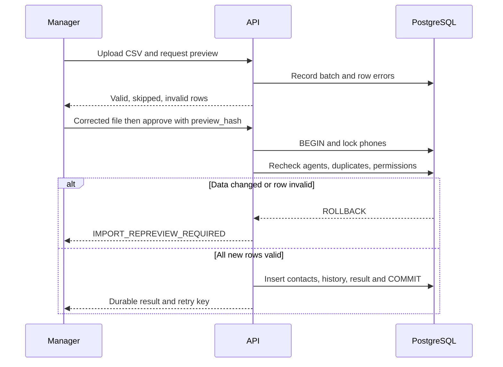
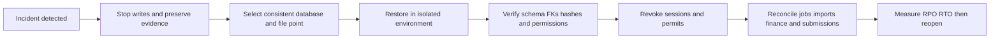

# Release, operations, and recovery

Status: local SP-21 recovery implemented; production infrastructure/procedure remains proposed  
Date: 2026-10-16  
Confirmed decisions: Vercel plus DigitalOcean Frankfurt; 30-day consistent database/file backups; target RPO one hour and RTO four hours; restore exercise and load target.  
Technical proposals: release sequence, supplementary backup, monitoring, and recovery controls.  
References: [architecture](../04-design/architecture.md), [security](../04-design/security-and-privacy.md), [tests](../05-quality/acceptance-tests.md), [lifecycle guide](../../software_engineering_lifecycle.md), KV note `Knowledge/Engineering/Cloud DevOps and Delivery.md`, [DigitalOcean managed PostgreSQL limits](https://docs.digitalocean.com/products/databases/postgresql/details/limits/), and [Spaces versioning](https://docs.digitalocean.com/products/spaces/how-to/enable-versioning/).

## Prepare each environment

The implemented same-laptop Windows procedure is the
[SP-21 local runbook](local-backup-recovery.md), with actual synthetic exercise
results in [execution](../03-planning/sprints/sp-21-execution.md). The cloud,
offsite storage and production rollout below have not been deployed or tested.
Current source authority must be available and unchanged for local opening;
total-source-loss/offline opening is not certified by this exercise.

Development, staging, and production have separate databases, buckets, secrets, cookies, and keys. Synthetic datasets serve testing until real KAY data is explicitly authorized. Configure the actual Vercel URL, actual DigitalOcean API URL, `DATABASE_URL`, `SPACES_*`, `FRONTEND_ORIGIN`, `FACADE_SECRET`, website-form secret, and backup keys as platform secrets, with no values in the repository. Production requires HTTPS, private buckets, running antivirus, worker, backup, and metrics. Choose instance sizes after load testing; this document commits to no SKU or cost.

Create a traceable release with commit/tag, frontend/backend/worker versions, Alembic migration, lockfiles, non-secret configuration, artifact hashes, tests, and a go-live decision. Apply compatible migrations before code that depends on them. For a breaking change, split expansion, cutover, and cleanup across releases. The development/unit hierarchy migration must preserve standalone property references and their existing offers/deals, populate new nullable links safely, then enforce same-development and offering-target constraints only after validation. Commands pass schema checks, source validation, pytest/Playwright tests, and dependency review. Staging exercises atomic import, denied actions, a 20 MB file, hierarchy/overlap conflicts, and restoration. A release fails its gate if this evidence is missing.

Production rollout follows a consistent backup/restore point, migration, backend/worker deployment, health and permission checks, first-administrator bootstrap **only for a new empty installation**, frontend deployment, authorized synthetic smoke test, closer monitoring, and a decision to open access. After migrations and before staff access, the intended first administrator runs and verifies the one-time server-local script in the [bootstrap runbook](admin-bootstrap.md). Do not run it on an existing installation, as a startup hook, or as a lost-admin recovery shortcut. Verify normal sign-in, later staff temporary-credential restrictions, and the audit event before opening accounts. The administrator configures real working days/hours and lunch breaks before staff book off-site visits; no schedule is invented as a deployment default, while company-car capacity starts at two per hour and office visits remain possible. Stage an administrator-only policy edit, capacity race, and office-outside-hours check before opening visit booking. On failure before opening, stop writes and restore according to compatibility. After a non-reversible migration or real writes, use a forward fix or controlled restore; rolling back only the frontend cannot repair a divergent database. Record exact time and state. Do not connect a real website form until its URL and authentication are identified and repeated delivery has been tested.

## Atomic import and interruption

Preview changes no contact. A manager corrects every invalid row; rows with known phones are listed as skipped. At approval, the database rechecks permissions, agents, numbers, and preview hash, then inserts every new row, history, and batch status in one transaction. A race requires a new preview. [Mermaid source](../../diagrams/import-atomic.mmd).

A crash before `COMMIT` creates no new contact; after `COMMIT`, the same batch/key returns its result without a second insertion. The original CSV and preview are protected as personal data; raw-file retention is still to be set. Export is also audited and delivered only after permissions are rechecked.

## Backups and objectives

The restore window must cover a rolling 30 days of consistent PostgreSQL and Spaces file copies, schema versions, and hashed manifests. DigitalOcean's native PostgreSQL point-in-time recovery has a shorter window, documented as seven days in its [provider limits](https://docs.digitalocean.com/products/databases/postgresql/details/limits/) at the time of writing. It cannot alone meet the 30-day goal. Proposed supplementary encrypted copies of data and object versions must produce a completed consistent restore point no older than one hour. Start with a 30-minute schedule and alert on lag, then adjust according to measured duration. Use separate backup storage, ideally another region with different credentials, and controlled 30-day retention. Spaces versioning can help retrieve objects but is not an independent backup. Include useful quarantined files, financial evidence, import batches, outbox, and authorization metadata. Each restore point links a PostgreSQL snapshot/LSN to an object-version manifest and compatible application version.

RPO ≤ 1 hour and RTO ≤ 4 hours are targets. An exercise measures the latest recoverable data point and the interval from incident declaration to verified service at the intended volume. If a provider or topology fails the targets, revise the design and retest rather than claim success.

## Restore in an isolated environment

The diagram shows the order of checks after an incident. [Mermaid source](../../diagrams/recovery.mmd).

Procedure: 1) timestamp the incident, isolate writes, and preserve logs and backups; 2) select the latest consistent point within RPO and a compatible artifact/migration; 3) restore database and objects with manifests in isolation; 4) check counts, foreign keys, same-development block/floor/type links, offering target exclusivity, project/unit overlap state, hashes, scans, balances, reservations, visit schedule policy/windows and permissions against fixtures; 5) revoke restored sessions/permits and review changes to roles, access, archiving, scheduling policy, and deletion since the chosen point; 6) resume fenced, deduplicated jobs and reconcile imports, website submissions, and financial operations with their evidence; 7) test sign-in, private contacts, shared development/unit inventory, protected files, search, role-scoped dashboard, and safe office/off-site visit booking; 8) measure and record RPO/RTO, obtain an opening decision, and publish a new endpoint if needed. Never blindly replay a deletion or restore revoked access.

The scheduled exercise uses synthetic data and records its date, responsible people, versions, volume, selected point, duration, measured loss, gaps, and actions. Security audit has its separate two-year period; transaction retention and international flows await the validation identified in [security and privacy](../04-design/security-and-privacy.md).

## Monitoring and change

Monitor API errors, p95 latency, database saturation and connections, outbox age, dead jobs, scan failures, backup lag, age of the latest proven restore, Spaces use, and orphaned files. Assign thresholds and on-call responsibility before production. Any BR change updates the linked model, API, and tests. Support receives an incident procedure and user guidance. Eventual retirement requires controlled export, approved retention, revocation, and verified deletion under a KAY decision.
