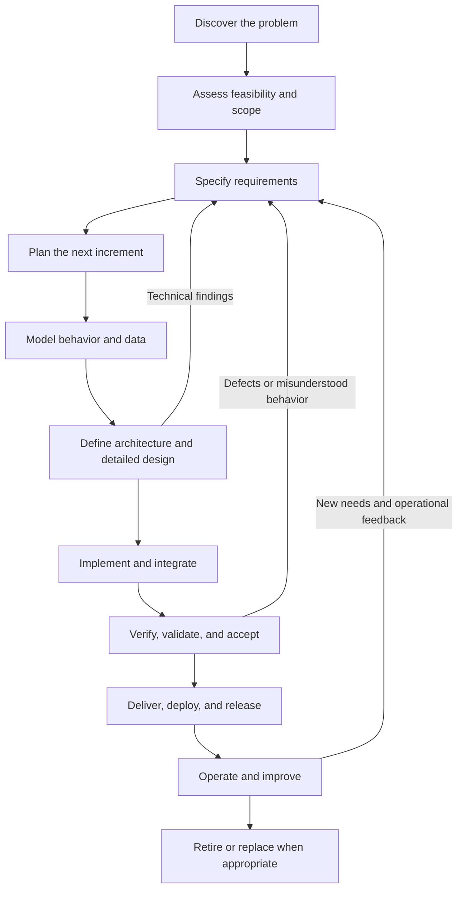
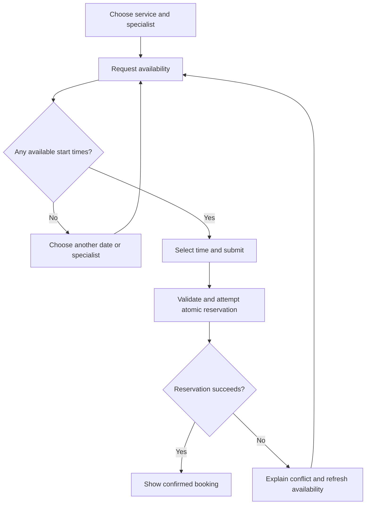
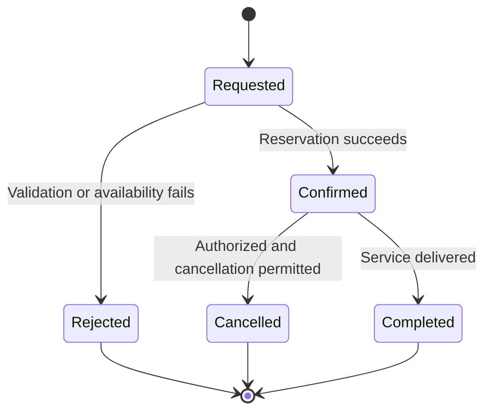
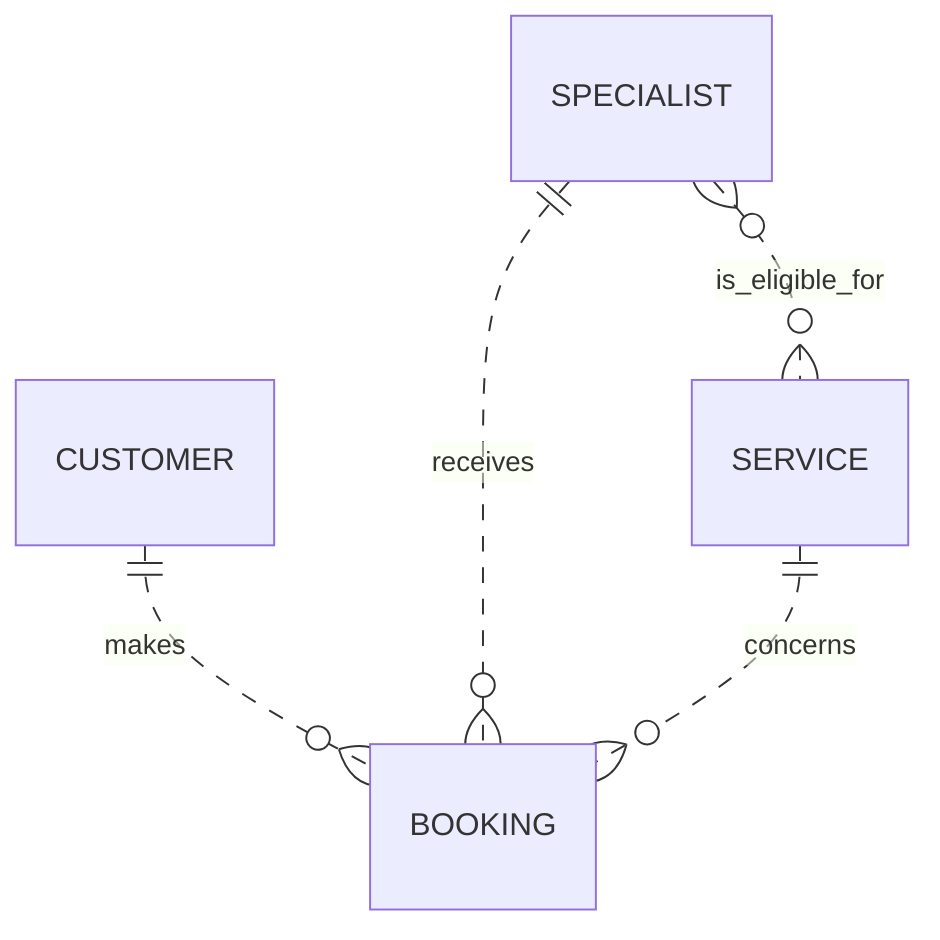
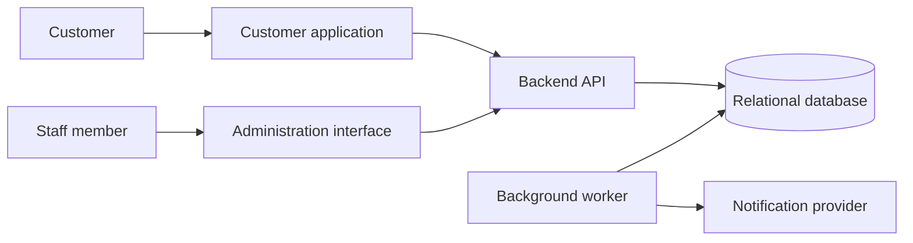
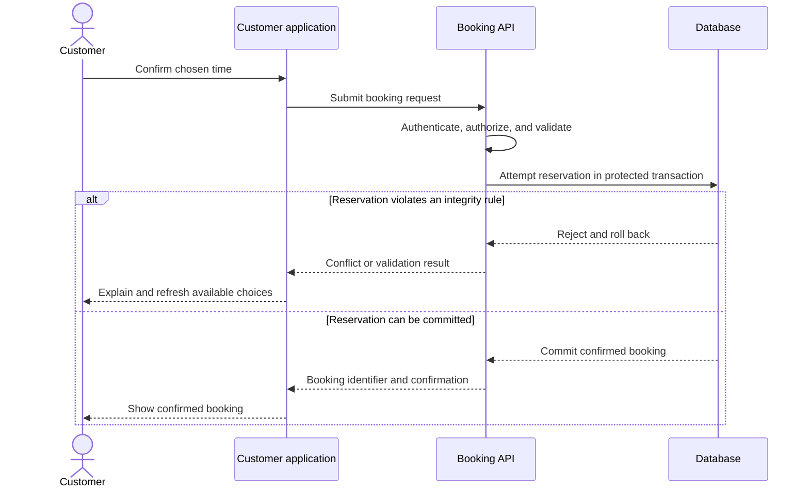

# Software Engineering Lifecycle

*A practical guide from business need to operation and retirement*

This guide explains the work involved in delivering a software project: what to understand, what to decide, what to prepare, which diagrams and models to use, and how to judge whether the next activity can begin.

It is intended to be used as a working project reference. The deliverables can be Markdown documents, diagrams, repository files, linked issues, executable specifications, or records in a project-management tool. Their content and consistency matter more than their format.

**The sequence below is a practical workflow, not a universally mandatory process.** Tailor its depth to the product's size, uncertainty, business impact, and assurance obligations. International lifecycle guidance allows activities to be performed iteratively, concurrently, and incrementally; it does not prescribe one development methodology or one document sequence. [R1](#r1)

A service-booking application is used throughout as an illustrative example. Its rules, targets, schemas, and design choices are examples, not requirements for every project.

> **Working principle:** Prepare enough evidence and shared understanding to make the next decision responsibly. Do not produce diagrams merely to fill a checklist, and do not skip analysis merely because development has already started.

## Contents

- [Lifecycle overview](#sec-lifecycle-overview)
- [Stage 1 — Discover the problem and the existing situation](#stage-1)
- [Stage 2 — Assess feasibility and establish scope](#stage-2)
- [Stage 3 — Specify requirements and prepare the project specification](#stage-3)
- [Stage 4 — Organize and plan delivery](#stage-4)
- [Stage 5 — Model processes, behavior, and user journeys](#stage-5)
- [Stage 6 — Model the data: dictionary, MCD, MLD, and MPD](#stage-6)
- [Stage 7 — Define the system architecture](#stage-7)
- [Stage 8 — Complete the detailed design for the next increment](#stage-8)
- [Stage 9 — Implement and integrate](#stage-9)
- [Stage 10 — Verify, validate, and obtain acceptance](#stage-10)
- [Stage 11 — Deliver, deploy, release, and hand over](#stage-11)
- [Stage 12 — Operate, maintain, and improve](#stage-12)
- [Stage 13 — Retire or replace the system](#stage-13)
- [Diagram and model selection guide](#sec-diagram-and-model-selection-guide)
- [Work that continues across every stage](#sec-work-that-continues-across-every-stage)
- [Traceability: connect the need to the evidence](#sec-traceability-connect-the-need-to-the-evidence)
- [Waterfall, the V-model, iterative delivery, and Agile](#sec-waterfall-the-v-model-iterative-delivery-and-agile)
- [Suggested project documentation structure](#sec-suggested-project-documentation-structure)
- [Reusable project templates](#sec-reusable-project-templates)
- [Readiness checklists](#sec-readiness-checklists)
- [Applying the lifecycle to a project already in development](#sec-applying-the-lifecycle-to-a-project-already-in-development)
- [Compact terminology reference](#sec-compact-terminology-reference)
- [References](#sec-references)

---

<a id="sec-lifecycle-overview"></a>

## Lifecycle overview

### The main stages

| Stage | Main question | Main preparation or evidence | Readiness decision |
|---|---|---|---|
| 1. Discover the problem | What needs to improve, and for whom? | Project brief, stakeholder map, current-process findings | The problem and desired outcomes are understood. |
| 2. Assess feasibility and scope | Is this worth doing, and what will we deliver first? | Options assessment, scope, risks, initial estimates, experiments | There is a credible, supported approach. |
| 3. Specify requirements | What must the system do, under which rules and constraints? | Requirements specification, business rules, acceptance criteria | The next scope is clear, feasible, and verifiable. |
| 4. Plan delivery | How will the team organize and evaluate the work? | Prioritized backlog, milestones, responsibilities, quality approach | The next delivery goal and dependencies are understood. |
| 5. Model behavior and user journeys | How do people, processes, and system states interact? | Use cases, workflows, state models, prototypes | Important scenarios and exceptions are defined. |
| 6. Model the data | What information exists, and what must remain consistent? | Data dictionary, MCD, MLD, integrity rules; initial MPD | The data model supports the intended behavior. |
| 7. Define architecture | What is the major structure of the solution? | Architecture views, decisions, interface boundaries, risk evidence | The structure can plausibly meet the important requirements. |
| 8. Complete detailed design | How will the next increment work internally and externally? | UI behavior, API contracts, sequences, physical schema, migrations | Implementation boundaries and failure behavior are understood. |
| 9. Implement and integrate | How do we turn the design into working software? | Reviewed code, automated checks, migrations, build artifacts | The integrated increment meets its completion criteria. |
| 10. Verify, validate, and accept | Does it meet requirements and solve the intended problem? | Test results, defect decisions, user feedback, acceptance record | Release risks and acceptance conditions are addressed. |
| 11. Deliver, deploy, and release | Can users safely start relying on it? | Release package, rollout and recovery plans, handover | The delivery is operable, supportable, and recoverable. |
| 12. Operate and improve | Is it reliable and useful in real use? | Monitoring, support records, incidents, improvement backlog | Ownership and continuous feedback remain effective. |
| 13. Retire or replace | How do we stop using it without losing necessary capabilities or data? | Transition plan, data disposition, decommissioning evidence | Dependencies and responsibilities are safely closed. |

### How the stages connect



This is an overview, not a rule that prohibits overlap. UX investigation, security, test design, risk management, and operational planning begin early. Physical database design evolves with architecture. Later findings can change earlier assumptions.

### Assign ownership, not unnecessary job titles

Identify who owns product priorities, domain decisions, technical decisions, design, testing, release approval, and production support. One person may cover several responsibilities on a small team. Record who can resolve disagreements and accept residual risks.

Each important artifact should identify its owner, status, last review, scope or release, and links to related records. A baseline is an agreed version used as a reference; changing it requires assessing and communicating the impact, not pretending it can never change.

---

<a id="stage-1"></a>

## Stage 1 — Discover the problem and the existing situation

**Purpose:** Understand the business situation before choosing a solution.

**Inputs:** An initial request, access to relevant stakeholders, and information about existing work.

### Work to perform

Investigate how the work happens today. Observe representative users, interview the people involved, examine existing tools and documents, and follow a real case from beginning to end. Distinguish observed problems from assumptions and requested features.

Establish the affected user groups, their goals, the people who approve decisions, and the people who will support the result. Include non-user stakeholders such as administrators, integration owners, and operations staff.

Define the intended outcomes and how you will assess them. For example, reducing manual scheduling effort is a business outcome; adding a calendar screen is a possible product feature.

### Questions to resolve

- What triggers the process, and what result should it produce?
- Where do delays, errors, duplicate entry, or handoff problems occur?
- Which exceptions require human judgment?
- What information is needed, created, or shared?
- Who is excluded or inconvenienced by the existing process?
- What evidence would demonstrate meaningful improvement?

### Prepare

| Deliverable | Contents |
|---|---|
| Project brief | Problem statement, affected users, goals, sponsor, initial boundaries. |
| Stakeholder and responsibility map | Interests, decision authority, operational responsibilities. |
| Current-state findings | Existing workflows, tools, pain points, evidence, limitations. |
| Domain glossary | Agreed meanings of important business terms. |
| Open-question log | Unknowns, assumptions, owners, and decisions needed. |

**Useful diagrams:** A high-level context diagram and an existing-process map. Use a swimlane workflow when responsibilities or handoffs are central to the problem.

**Example:** Staff currently exchange appointment updates through messages and maintain separate calendars. The objective is a shared, reliable booking process with fewer scheduling conflicts.

**Ready to proceed when:** The stakeholders and team agree on the problem, affected people, intended improvement, and initial system boundary. Important unknowns are visible rather than silently treated as facts.

---

<a id="stage-2"></a>

## Stage 2 — Assess feasibility and establish scope

**Purpose:** Decide whether and how to invest in a solution.

**Inputs:** Discovery findings, constraints, available resources, and initial objectives.

### Work to perform

Compare plausible options: improving the current process, configuring an existing product, integrating available systems, building custom software, or combining these approaches.

Evaluate technical feasibility, adoption needs, development and operating effort, team skills, integration access, delivery constraints, and supplier dependencies. Identify applicable contractual, privacy, accessibility, and other obligations with the responsible specialists; do not assume a generic checklist settles those obligations.

Investigate the assumptions most capable of invalidating the project. Use a proof of concept for technical uncertainty and a user prototype for interaction uncertainty. State what each experiment must demonstrate before running it.

### Define scope explicitly

Separate what belongs in the first release from later possibilities and explicit exclusions. Include administration, support, data migration, and error handling where they are necessary for a usable release.

For the example:

| First release | Deferred | Excluded from this example |
|---|---|---|
| Service catalog, specialist availability, booking, cancellation, staff schedule | Automated reminders and richer reporting | Online payments, loyalty points, marketplace settlement |

An MVP is the smallest scope that can meaningfully test an important product assumption while meeting the quality needed for its actual use. It is not permission to ignore essential security or integrity requirements.

### Prepare

An options assessment, scope statement, initial delivery and operating estimates, major dependencies, experiment results, and a risk register. Record estimate assumptions and uncertainty rather than presenting an early forecast as a guarantee.

A risk entry should include the uncertain event, possible impact, likelihood or assessment, owner, response, and a trigger for revisiting it. Keep current issues separate from future risks.

**Useful diagrams:** A context view comparing boundaries or integrations; a dependency map where outside organizations affect feasibility.

**Ready to proceed when:** There is a viable approach, an agreed first scope, a credible resource commitment, and an explicit decision about the major risks. Pause or revise the scope when essential feasibility evidence is missing.

---

<a id="stage-3"></a>

## Stage 3 — Specify requirements and prepare the project specification

**Purpose:** Turn the business need into a shared, testable description of expected behavior.

**Inputs:** Agreed scope, discovery evidence, domain knowledge, constraints, and feasibility findings.

Requirements engineering includes eliciting, analyzing, specifying, validating, and managing requirements throughout the lifecycle. Requirements may evolve as understanding improves. [R2](#r2)

### Distinguish the different kinds of information

| Kind | What it describes | Example |
|---|---|---|
| Business objective | The improvement being pursued | Reduce staff time spent arranging appointments. |
| User need | What a person needs to accomplish | Find and reserve a suitable appointment. |
| Functional requirement | Observable system behavior | Show available start times for the selected specialist and service. |
| Business rule | A domain condition or restriction | Confirmed appointments for one specialist must not overlap. |
| Quality requirement | A measurable quality of the solution | Availability searches meet an agreed response-time target under a defined workload. |
| Constraint | An imposed limit on the solution or work | Integrate with an existing identity provider. |
| Interface requirement | An external interaction or exchange | Send an agreed notification payload to a delivery service. |
| Acceptance criterion | Evidence that a specific expectation is satisfied | A conflicting request is rejected without creating a second confirmed booking. |

These classifications can overlap. A security objective can produce functional requirements for permissions, quality requirements for protection, and constraints on data handling.

### Write identifiable requirements

Give each important requirement an identifier, clear statement, rationale, source, priority, acceptance or verification method, and status. Link it to the relevant business rule and user goal.

Illustrative requirements:

| ID | Requirement |
|---|---|
| FR-01 | The system shall return available start times for a selected service, specialist, and date. |
| FR-02 | The system shall allow an authorized customer to request a booking for an eligible service and specialist. |
| FR-03 | The system shall prevent overlapping confirmed bookings for the same specialist, including requests processed concurrently. |
| FR-04 | The system shall permit a customer to cancel their own confirmed booking when its start time is at least 24 hours in the future. |
| FR-05 | The system shall allow authorized staff to view the schedule they are permitted to manage. |

The cancellation rule above deliberately includes the exact 24-hour boundary. A different policy would require different criteria and tests.

### Make quality requirements measurable

The following numbers are illustrative targets, not universal recommendations.

| Concern | Example requirement | What must also be defined |
|---|---|---|
| Performance | 95% of availability requests complete within 500 ms at the API boundary. | Test workload, dataset, hardware, duration, excluded operations, and measurement method. |
| Recoverability | Restore the service within four hours after the specified failure, losing no more than one hour of data. | Failure scenario, restore scope, dependencies, recovery evidence, and responsible owner. |
| Usability | At least 9 of 10 representative first-time participants complete the booking task without assistance. | Representative participants, task, environment, completion criteria, and test procedure. |
| Authorization | Customers can access only their own bookings; staff access is restricted to their assigned scope. | Roles, resource ownership, exceptional privileges, and negative test cases. |
| Accessibility | The agreed journeys satisfy the project's selected accessibility target. | Applicable criteria, devices, assistive technology, and evaluation method. |

Avoid unqualified statements such as “fast,” “secure,” “scalable,” or “user-friendly.” Requirements review should examine clarity, correctness, feasibility, necessity, consistency, and verifiability. [R3](#r3)

### Define rules and edge cases before they become hidden code

For the booking example, resolve whether pending requests reserve capacity, how specialist qualifications work, whether preparation time is included, how time zones are interpreted, and whether back-to-back intervals are allowed.

Also discuss invalid inputs, authorization failures, duplicates, concurrent actions, cancellations, disconnected clients, and unavailable integrations.

### Use stories and acceptance criteria appropriately

A user story can express intent:

> As a customer, I need to cancel an eligible appointment so that I can release a time I can no longer attend.

It does not replace the underlying rule or exception handling.

Example acceptance scenario:

```gherkin
Scenario: Cancel at the permitted boundary
  Given a customer owns a confirmed booking
  And the booking starts exactly 24 hours after the server's current time
  When the customer requests cancellation
  Then the booking becomes cancelled
  And its capacity becomes available for a new booking
```

Add scenarios for a request inside the restricted interval, another customer's booking, repeated cancellation, and a state that cannot be cancelled.

### Prepare the project specification

The **project specification**, often called a *cahier des charges*, describes the expected project and its acceptance conditions. A **Software Requirements Specification (SRS)** focuses on the software requirements. A **Product Requirements Document (PRD)** often emphasizes product goals and experience. Organizations use these names differently; agree on content and ownership rather than producing duplicate documents.

A practical specification contains:

1. Context, objectives, stakeholders, and glossary.
2. Scope, exclusions, assumptions, and dependencies.
3. User roles and expected operating conditions.
4. Functional requirements and business rules.
5. Quality requirements and constraints.
6. Data requirements and external interfaces.
7. Relevant workflows, use cases, and user journeys.
8. Acceptance and verification approach.
9. Expected deliverables and milestones.
10. Decisions, open questions, and change history.

**Useful diagrams:** Context, use-case, workflow, and early conceptual data views. These explain requirements; they do not substitute for precise rules.

**Ready to proceed when:** The next increment's requirements are understood, prioritized, feasible, and verifiable. Conflicts are resolved or explicitly owned, and the people responsible for business acceptance agree with the intended behavior.

---

<a id="stage-4"></a>

## Stage 4 — Organize and plan delivery

**Purpose:** Turn the agreed objectives into executable, reviewable work.

**Inputs:** Scope, prioritized requirements, constraints, team capacity, and initial technical risks.

### Work to perform

Decompose the work into meaningful outcomes, establish dependencies, assign responsibilities, and plan how the team will inspect progress. Include discovery, technical experiments, environments, data preparation, testing, security review, documentation, migration, and rollout.

Prefer increments that provide a coherent end-to-end capability when feasible. For example, “create a booking that appears in the staff schedule” gives more useful feedback than separately completing every database table, then every API, then every screen.

Keep a product backlog for product work and a delivery plan for major outcomes, dependencies, and commitments. Re-estimate when evidence changes. Reserve capacity for defects and uncertainty rather than hiding them outside the plan.

### Planning artifacts you may need

| Artifact | Purpose | When it is useful |
|---|---|---|
| WBS: work breakdown structure | Break down the project's work into manageable components. | Scope and work packages need explicit decomposition. |
| Product backlog | Order remaining product changes and improvements. | Priorities evolve over time. |
| Roadmap or release plan | Communicate intended outcomes and approximate sequencing. | Stakeholders need a shared delivery direction. |
| Gantt chart | Show activities, dates, milestones, and dependencies. | Scheduling and coordination are important. |
| Dependency network / PERT | Analyze dependent work and duration uncertainty. | Complex dependencies affect delivery. |
| RACI matrix | Identify responsibility, accountability, consultation, and information needs. | Decision ownership is unclear across multiple parties. |
| Risk and issue registers | Track uncertainty and active problems. | Work has meaningful delivery or operational risks. |

A milestone should correspond to evidence or an outcome, such as a validated prototype, a successful migration rehearsal, or an accepted increment.

### Define quality expectations early

Agree on review practices, testing responsibilities, security checks, documentation expectations, and release conditions. Record a shared **Definition of Done** for increments or completed work.

A team's optional readiness checklist helps decide whether an item is understood enough to start. It should not become a bureaucratic barrier to learning.

**Prepare:** Prioritized work, responsibilities, delivery dependencies, estimates and assumptions, milestones, quality approach, communication rhythm, and an updated risk register.

**Ready to proceed when:** The next outcome, its owner, its dependencies, and its completion evidence are clear. The team has the access and capacity needed to begin.

---

<a id="stage-5"></a>

## Stage 5 — Model processes, behavior, and user journeys

**Purpose:** Make interactions, responsibilities, decisions, exceptions, and state changes understandable before implementing them.

**Inputs:** Requirements, business rules, glossary, user research, and current-process findings.

### Describe use cases

A **use case** describes an actor pursuing a goal through the system. A use-case diagram identifies actors and supported goals; a written scenario describes the behavior in sufficient detail.

For each important use case, record its actor, trigger, preconditions, normal sequence, alternatives, errors, postconditions, and linked requirements.

Example:

| Field | UC-01: Book an appointment |
|---|---|
| Actor | Customer |
| Trigger | The customer chooses to reserve a service. |
| Preconditions | The customer is authenticated; the service and specialist are bookable. |
| Normal flow | Select service, choose specialist, request availability, choose time, submit, receive confirmation. |
| Alternatives | No available time, invalid input, specialist becomes unavailable, conflicting request, interrupted connection. |
| Success outcome | A confirmed booking exists and is visible to the authorized customer and staff. |
| Failure outcome | No conflicting confirmed booking is created; the customer receives an actionable result. |

The actor may also be an external system. Keep implementation details out of the use case unless they are necessary to express the requirement.

### Model a workflow

Use an activity diagram, flowchart, or BPMN process where the sequence and responsibilities need discussion. Label the notation accurately; a generic flowchart is not automatically a formal UML activity diagram or BPMN model.

Illustrative booking flowchart:



Availability shown earlier is advisory: confirmation must still enforce the current rules at the moment the reservation is made.

### Model the lifecycle of important objects

A state model makes valid states and transitions explicit. For this example, a requested booking does not reserve capacity; only confirmation does. This is an illustrative policy.



For each transition, define the initiating actor or event, required conditions, side effects, audit needs, and behavior when the request is repeated. A model may omit states deliberately; record those limits.

### Map the user experience

Define user journeys, screen navigation, information hierarchy, and important interactions. Validate uncertain behavior with representative users before polishing every screen.

Include loading, empty, success, partial-success, validation-error, permission-denied, and unavailable-service states. Cover accessibility and supported languages where they are in scope.

### Understand the different meanings of “flow diagram”

| Model | Primary focus |
|---|---|
| Information-flow / MERISE communication model | Information exchanged between actors or domains. |
| Data-flow diagram (DFD) | Data movement among external entities, processes, and stores. |
| Activity diagram or flowchart | Actions, conditions, branching, and possibly parallel work. |
| BPMN process | Business activities, events, responsibilities, and process/message coordination. |
| Sequence diagram | Messages among participants in a particular scenario over time. |

For a DFD, a context view typically treats the system as one process. More detailed views decompose processing while preserving consistent external inputs and outputs. A DFD is not a database schema or a time-ordered execution trace.

**Prepare:** Written use cases, selected workflows, important state models, user journeys, prototype findings, and resolved behavior questions.

**Ready to proceed when:** The team can explain the important journeys, business decisions, alternatives, and failure outcomes without relying on contradictory assumptions.

---

<a id="stage-6"></a>

## Stage 6 — Model the data: dictionary, MCD, MLD, and MPD

**Purpose:** Define the information the system manages and the rules that keep it meaningful and consistent.

**Inputs:** Domain glossary, requirements, business rules, workflows, and representative data.

### Data model versus database model

A **data model** describes information, its meaning, relationships, and constraints. A **database model or schema** usually refers to how that information is organized for storage.

The distinction becomes clearer through three levels:

| Level | French name | Main question | Typical content |
|---|---|---|---|
| Conceptual | MCD — Modèle Conceptuel des Données | What exists in the business, and how is it related? | Entities, attributes, identifiers, associations, cardinalities. |
| Logical | MLD — Modèle Logique des Données | How is that information represented in the chosen data model? | Relations/tables, primary keys, foreign keys, logical constraints. |
| Physical | MPD — Modèle Physique des Données | How will the selected database implement it? | Specific types, indexes, database constraints, DDL, storage choices. |

These are levels of reasoning, not a requirement to draw the same diagram three times. The MCD and MLD usually become useful before implementation; the MPD is refined alongside architecture and detailed design.

### 6.1 Create a data dictionary

Define names, meanings, domains, units, optionality, validation, source, sensitivity, and retention considerations. Separate missing values from empty strings, zero, and “not applicable” where the distinction matters.

| Item | Meaning | Rule or question |
|---|---|---|
| booking_id | Stable identifier of a booking | Unique; not a substitute for authorization. |
| starts_at | Beginning of the reserved interval | Represent the intended instant unambiguously. |
| ends_at | End of the reserved interval | Must be later than starts_at. |
| status | Current business state | One of the agreed states. |
| service duration | Expected time needed | Define whether preparation and cleanup are included. |
| contact email | Address used to contact a customer | Requiredness, validation, privacy, and uniqueness need explicit policy. |

Specify the treatment of business-local times, time zones, daylight-saving transitions where applicable, and recurring schedules. An appointment instant and “every Monday at 09:00 local time” are different concepts.

### 6.2 Build the MCD: conceptual model

Identify the domain entities, their identifiers and attributes, and their associations without choosing SQL column types or indexes. For example, a Booking has an identifier, a time interval, and a state; its customer and specialist are conceptual associations, not yet foreign-key columns.

For the example, assume:

- Each booking concerns exactly one customer, one specialist, and one service.
- A customer, specialist, or service can exist before any bookings exist.
- A specialist can be eligible for several services, and a service can have several eligible specialists.

Common cardinalities:

| Notation | Meaning |
|---|---|
| `(0,1)` | Zero or one association occurrence. |
| `(1,1)` | Exactly one. |
| `(0,N)` | Zero or many. |
| `(1,N)` | One or many. |

The following is a conceptual entity-relationship illustration using Mermaid's crow's-foot notation, **not strict MERISE graphical notation**:



Here `||` means exactly one, `o{` means zero or many at the right end, and `}o` means zero or many at the left end. The first relationship states that each booking has exactly one customer while a customer may have no bookings or many bookings.

List rules that the diagram cannot express clearly, such as non-overlapping intervals, eligibility at the booking time, and permitted status changes.

### 6.3 Derive the MLD: logical model

For a relational implementation, map the concepts to relations with keys and references.

```text
Customer(
    customer_id PK,
    name,
    contact_email
)

Specialist(
    specialist_id PK,
    name
)

Service(
    service_id PK,
    name,
    default_duration_minutes
)

SpecialistService(
    specialist_id PK FK -> Specialist.specialist_id,
    service_id    PK FK -> Service.service_id
)

Booking(
    booking_id PK,
    customer_id FK -> Customer.customer_id,
    specialist_id FK -> Specialist.specialist_id,
    service_id FK -> Service.service_id,
    starts_at,
    ends_at,
    status,
    created_at
)
```

`SpecialistService` has one composite primary key consisting of both columns. It represents the many-to-many eligibility relationship.

This schema is deliberately partial. It does not include identity storage, staff working schedules, time off, audit records, multi-business isolation, or notification delivery records. Add the structures required by the real scope. The two separate foreign keys in `Booking` do not, by themselves, prove that its specialist is eligible for its service.

#### Common relationship transformations

- **One-to-many:** Place a foreign key on the many side; decide its nullability from the business rule.
- **Many-to-many:** Introduce an association relation, including any attributes of the relationship.
- **One-to-one:** Choose placement carefully and enforce the appropriate uniqueness and optionality. Merging may be suitable, but is not automatic.
- **Self-reference:** Use an explicit relationship when one occurrence refers to another occurrence of the same entity type.
- **Subtype relationships:** Choose a mapping strategy based on identity, optional data, integrity needs, and queries; do not assume every class becomes a table.

#### Review functional dependencies and normalization

A functional dependency states that one set of attributes determines another. Use the actual business rules and all candidate keys when assessing normalization.

As a practical reminder, first normal form concerns relational values without repeating groups; second normal form removes partial dependencies of non-prime attributes on a proper subset of a candidate key; third normal form additionally requires that, for a nontrivial dependency `X -> A`, `X` is a superkey or `A` is a prime attribute. A prime attribute belongs to at least one candidate key. These definitions build on the preceding normal forms. [R14](#r14)

For example, repeatedly copying a specialist's current name into every booking creates multiple places to update the same fact. A deliberate historical snapshot is different: storing a service description or agreed duration as it was when booked may be a valid historical requirement. Explain such duplication rather than automatically removing it.

### 6.4 Refine the MPD: physical model

Choose implementation details for the database you actually selected:

| Decision | Examples of questions |
|---|---|
| Identifiers and types | What identifier type, timestamp representation, precision, length, and encoding are required? |
| Nullability and defaults | Which values must exist, and which defaults reflect a real rule? |
| Integrity constraints | What checks, references, uniqueness, or range constraints belong in the database? |
| Indexes | Which measured or expected access patterns justify an index? |
| Transactions | Which changes must succeed or fail together? |
| History and deletion | Should changes be audited, versioned, restricted, anonymized, or removed? |
| Migration | How will existing data and older application versions remain compatible during changes? |
| Access and recovery | Which database roles, backups, and restore procedures are needed? |

For a non-relational database, still separate conceptual understanding from logical and physical design. Model document boundaries, access patterns, consistency, duplication, and update rules explicitly rather than forcing a relational schema onto every storage technology.

### 6.5 Enforce integrity under concurrency

Checking availability and then inserting without suitable protection can allow competing requests to observe the same free slot.

Choose an atomic enforcement mechanism suitable for the database and booking model. Possibilities include an appropriate database constraint, a correctly designed locking scheme, or a transaction isolation strategy with the required retry handling. “Inside a transaction” alone does not establish that a concurrency rule is protected.

For interval-based reservations, PostgreSQL documents exclusion constraints that can prevent overlapping ranges for the same resource. This is one implementation option, not a universal database feature. [R4](#r4)

In this example, define intervals as `[start, end)`: the start is included, the end excluded, so an appointment ending at 10:00 can be followed by one starting at 10:00. Decide which statuses consume capacity, and align application logic, database enforcement, and tests.

### 6.6 Plan data migration when replacing an existing system

Inventory sources, map old fields to new meanings, identify duplicates and invalid records, define transformation rules, and rehearse imports. Compare counts and important business totals, investigate exceptions, and determine how writes will be handled during the final transition.

Document recovery and reconciliation. A technically successful import is not enough when it changes the business meaning of data.

**Prepare:** Data dictionary, conceptual model, logical schema, integrity rules, initial physical design, and migration requirements. Version them with the related requirements and implementation.

**Ready to proceed when:** The model supports the use cases; cardinalities, ownership, identities, historical behavior, and critical integrity rules are understood; and the physical design can be completed without inventing unresolved business policy.

---

<a id="stage-7"></a>

## Stage 7 — Define the system architecture

**Purpose:** Decide the major structure and technical responsibilities of the solution.

**Inputs:** Architecturally significant requirements, system boundary, data model, integrations, team constraints, and feasibility evidence.

### Work to perform

Identify applications, deployable units, internal modules, data stores, external dependencies, and their responsibilities. Decide where rules are enforced, which system owns each kind of data, and how failures are contained and recovered from.

Evaluate the qualities that drive structural choices: security, consistency, throughput, responsiveness, availability, maintainability, deployment independence, and operating effort. Compare options against those needs rather than choosing architecture by popularity.

A modular backend may be a suitable initial candidate for a small application. Independently deployed services may be justified by different ownership, scaling, isolation, or release needs. Record the tradeoffs; neither choice is universally correct.

### Prepare the main architecture views

| View | What to show |
|---|---|
| System context | Users, the system boundary, neighboring systems, and major interactions. |
| Application / container view | Applications, services, data stores, responsibilities, and communication. |
| Component view | Important internal components and their interfaces where detail helps. |
| Deployment view | Environments, runtime nodes, network boundaries, and deployed software. |
| Security / trust-boundary view | Sensitive assets, entry points, identity boundaries, and important threats. |

C4 provides context, container, component, and code-level views; use the levels that help your audience. In this terminology, a container is an application or data store, not necessarily an operating-system container. [R6](#r6)

Illustrative application-level view, expressed as a generic flowchart rather than formal C4 notation:



The notification worker is only needed when that capability is in scope. The diagram does not prescribe a cloud provider, framework, microservice architecture, or orchestration platform.

### Decide important operational and security behavior

Define authentication and authorization boundaries, resource ownership, privileged access, secret handling, and sensitive-data exposure. For a multi-business product, establish how one business is prevented from reading or modifying another's data.

Plan timeouts, retry limits, duplicate handling, failure reporting, and degraded behavior for integrations. Identify single points of failure and assess whether they are acceptable for the requirements.

Sketch how builds reach environments, how database changes are introduced, how the system is observed, and how it can recover. Operational needs can change architectural decisions.

### Record architecture decisions

Use an **Architecture Decision Record (ADR)** for significant choices. Record context, options, decision, rationale, consequences, status, and conditions for reconsideration. Link the decision to the requirement or risk it addresses.

A useful ADR explains why the team selected its database or module boundaries; it does not merely announce the choice.

**Prepare:** Architecture views, important ADRs, interface ownership, an initial threat model, deployment assumptions, and results from high-risk technical experiments.

**Ready to proceed when:** The architecture has a credible route to meeting the important requirements, major interfaces have owners, and unresolved technical risks have an explicit investigation or mitigation plan.

---

<a id="stage-8"></a>

## Stage 8 — Complete the detailed design for the next increment

**Purpose:** Make the next implementation coherent across UI, application logic, APIs, persistence, and integrations.

**Inputs:** Agreed requirements, behavior models, conceptual/logical data models, and architecture decisions.

### Specify the user interface

Define screen behavior, navigation, validation, permissions, responsive behavior, accessibility, and relevant visual components. Specify what happens when information is missing, a request is processing, access is denied, or a displayed slot is no longer available.

Link screens to the user journeys and acceptance criteria. A polished mockup does not define every interaction or business rule.

### Define API and event contracts

An interface contract should identify its consumers, authentication, authorization, inputs, outputs, validation, errors, and compatibility expectations. Where relevant, include pagination, ordering, rate limits, retries, idempotency, versioning, and timeout behavior.

For example:

| Operation | Successful behavior | Important alternatives |
|---|---|---|
| Search availability | Returns available intervals for the requested scope. | Invalid date, unbookable service, unavailable dependency. |
| Create booking | Creates one confirmed reservation after enforcing current rules. | Conflict, invalid input, insufficient permissions, repeated request. |
| Cancel booking | Applies the permitted state transition and releases capacity. | Deadline passed, wrong owner, incompatible state, already cancelled. |

For asynchronous messages, define the event meaning, schema, producer, consumers, identifiers, ordering assumptions, duplicate handling, and failure recovery. Do not assume message delivery automatically produces an exactly-once business effect.

### Design internal responsibilities and algorithms

Specify modules, interfaces, relevant classes, transaction boundaries, and the algorithms that matter. Address cohesion, coupling, encapsulation, and testability. Use design patterns where they solve an actual design problem.

A **class diagram** models software or domain structure; a **database schema** models stored information. They may overlap, but an object is not automatically a table, and an inheritance relationship is not automatically a foreign key.

A sequence diagram is useful for important interactions. This simplified example assumes the database mechanism protects against concurrent overlap:



This diagram omits retry, idempotency, and notification details deliberately. Specify them separately when required. For example, an idempotency design should define key scope, request matching, simultaneous duplicates, retention, and replayed results.

### Finish physical data and migration design

Prepare the required DDL or migrations, indexes, constraints, transaction behavior, and compatibility rules. Clarify whether an older application version can operate against the changed schema during rollout or recovery.

For side effects such as notifications, decide how to avoid losing the work between committing a booking and sending a message. An outbox processed by a worker is one possible design: the booking and a record of pending notification work are committed together. Delivery can still be repeated, so handling duplicates remains necessary.

**Prepare:** Detailed functional/technical specification for the increment, UI behavior, API or event contracts, selected class/sequence diagrams, schema migrations, and relevant algorithm or failure-handling notes.

**Ready to proceed when:** Engineers can implement their parts without inventing incompatible contracts, business rules, or failure behavior. Difficult decisions have evidence or a bounded experiment, not an unexplained placeholder.

---

<a id="stage-9"></a>

## Stage 9 — Implement and integrate

**Purpose:** Turn agreed behavior and design into integrated, reviewable software.

**Inputs:** Ready work items, detailed design, development access, environments, and shared completion criteria.

### Establish an effective development foundation

Prepare a repository, reproducible setup instructions, dependency management, configuration templates, formatting and static checks, test execution, and an automated build. Separate environment configuration from code and protect credentials appropriately.

Agree on how changes are reviewed and integrated. Keep changes small enough to understand and test. Review migrations, infrastructure changes, authorization, and error behavior as carefully as visible feature code.

### Implement vertical increments

For each change, confirm its requirement and acceptance criteria, implement the necessary behavior, add appropriate tests, run checks, review the change, and integrate it with the rest of the system.

Keep temporary experiments distinguishable from production-ready implementation. A proof of concept may answer a technical question while lacking the error handling, permissions, and operational support needed for real users.

### Use continuous integration

Continuous integration combines frequent integration with automated build and test feedback. Its purpose is to detect integration problems while changes are still small; a broken shared build should be investigated and repaired promptly. [R9](#r9)

A possible pipeline is:

```text
Check out a reviewed revision
  -> restore controlled dependencies
  -> run formatting, linting, and static checks
  -> run unit/component tests
  -> build a versioned artifact
  -> run integration and migration checks in a suitable environment
  -> run relevant security and dependency checks
  -> publish the artifact and evidence when required checks pass
```

Tailor checks and ordering to feedback speed and risk. A passing pipeline is evidence of the checks it actually performs, not a guarantee of product correctness.

### Maintain configuration control

Track the relationship between source revisions, dependency versions, configuration definitions, schema migrations, infrastructure, and built artifacts. Make it possible to answer “what is running?” and “how was it produced?”

Do not keep production secrets in source control or documentation. Record references and access procedures instead.

**Prepare:** Reviewed integrated code, meaningful automated tests, migrations, reproducible build artifacts, review evidence, updated contracts, and the documentation affected by the change.

**Ready to proceed when:** The increment meets its agreed Definition of Done, works in the integrated system, and has no unexamined deviations from its requirements or design.

---

<a id="stage-10"></a>

## Stage 10 — Verify, validate, and obtain acceptance

**Purpose:** Collect enough evidence to decide whether the product satisfies its requirements and intended use.

**Inputs:** Requirements and acceptance criteria, integrated software, test environments, representative data, and the earlier test strategy.

**Verification** evaluates conformity to specified requirements. **Validation** evaluates fitness for the intended use and stakeholder need. Reviews, analysis, demonstrations, and testing can contribute evidence. Begin these activities before implementation is finished. [R16](#r16)

### Distinguish test levels from test purposes

| Level | Focus | Booking example |
|---|---|---|
| Unit / component | A small component or behavior in isolation. | Cancellation deadline calculation. |
| Component integration | Interactions between internal components. | Booking service and database access. |
| System | The complete application within its defined boundary. | A customer books and staff see the reservation. |
| System integration | Interactions with external systems. | Correct behavior when the notification provider is unavailable. |
| Acceptance | Suitability for agreed business use or delivery. | Staff execute realistic scheduling and cancellation scenarios. |

Testing at different scopes answers different questions, and test design should reflect the requirements and risks being assessed. [R11](#r11)

Performance, security, accessibility, usability, recovery, and regression testing are purposes or concerns that can apply at different levels. An end-to-end test follows a complete journey; it is not a replacement for more focused tests.

### Build a risk-based test plan

Specify the scope, features and qualities to assess, environments, test data, responsibilities, evidence, entry conditions, and release criteria. Record omissions and their rationale.

Use test techniques suitable to the behavior: representative input classes, boundary values, decision tables, state-transition coverage, exploratory testing, and concurrency or failure scenarios where applicable.

For the example, investigate:

| Concern | Scenarios |
|---|---|
| Time boundaries | Exactly at the cancellation deadline; immediately before and after it. |
| Interval rules | Same interval, partial overlap, contained interval, and back-to-back appointments. |
| Authorization | Own booking, another customer's booking, and staff outside their permitted scope. |
| Concurrency | Competing reservations; cancellation racing with another relevant operation. |
| Retries | Interrupted response and repeated submission; duplicate external message. |
| States | Valid transition, invalid transition, repeated transition, and stale client data. |
| Recovery | Restore from backup and validate the resulting business data. |
| Integrations | Slow response, rejected request, malformed result, timeout, and outage. |

Use synthetic or appropriately protected data. Do not casually copy sensitive production records into test environments.

### Record and triage defects

A useful defect record includes the affected version and environment, reproduction steps, expected and observed behavior, evidence, business impact, severity, owner, and status.

Severity describes impact; priority describes when the team should address it. Fix, retest, and consider regression coverage. Explicitly document defects accepted for release, including why and by whom.

### Conduct acceptance testing and decide

Business representatives evaluate the agreed scenarios and quality evidence. Record acceptance, conditional acceptance, or rejection, together with limitations and remaining work.

A test pass does not prove the absence of all defects. Judge coverage and evidence against the product's actual risks rather than relying on a single percentage.

**Prepare:** Test plan and cases, results, requirements coverage, defect decisions, quality measurements, user feedback, and an acceptance record.

**Ready to proceed when:** Required acceptance conditions are met, release-blocking problems are resolved, and authorized decision-makers understand the remaining risks and limitations.

---

<a id="stage-11"></a>

## Stage 11 — Deliver, deploy, release, and hand over

**Purpose:** Put an accepted version into use with controlled rollout, support, and recovery.

**Inputs:** Accepted release candidate, test evidence, operational preparation, migration design, and a release decision.

### Separate three events

| Term | Meaning |
|---|---|
| Delivery | Handing over the agreed software, documentation, and related materials. |
| Deployment | Installing or updating software in a target environment. |
| Release | Making functionality available to intended users. |

These events can happen separately. For example, software may be deployed while a feature remains disabled until release approval.

Continuous delivery keeps changes in a state where they can be released on demand. Continuous deployment goes further by automatically deploying qualifying changes to production. A deliberate production decision is compatible with continuous delivery. [R10](#r10)

### Prepare the release package

Identify the exact version, artifact, included changes, dependencies, schema changes, configuration requirements, known limitations, support contacts, and required approvals.

Promote a controlled artifact through the environments where practical. Avoid silently rebuilding a different artifact for production after testing another one.

### Rehearse deployment and data changes

Define deployment order, compatibility needs, expected downtime or degraded behavior, configuration updates, migrations, verification checks, and stop conditions.

For existing data, rehearse transformation, import, reconciliation, and cutover. Decide how writes are managed during the transition and how the team will detect incomplete migration.

### Define recovery before launch

State what triggers stopping, reverting, or rolling forward; who decides; what is recoverable; and how recovery is verified.

A rollback of application code may not undo a destructive schema migration or a changed business record. Design a compatible rollout or explicit data-recovery procedure as appropriate. Test restore procedures rather than relying only on successful backup logs.

Operational launch reviews should assess the architecture, dependencies, capacity assumptions, failure behavior, and readiness to support the service. Scale the review to the system's risk. [R12](#r12)

### Complete operational handover

Provide runbooks, monitoring, alert ownership, escalation paths, user guidance, administrator instructions, and access-transfer procedures. Demonstrate how an operator diagnoses a likely failure and how support handles a common user problem.

Check the live critical journeys after deployment. A running process is not sufficient evidence that login, data access, and booking actually work.

**Prepare:** Versioned release, release notes, rollout and recovery plans, migration evidence, operational documentation, training or guidance, access handover, and post-deployment results.

**Ready to proceed when:** The deployed version is verified in its target environment, release conditions are satisfied, and named owners can operate, support, and recover it.

---

<a id="stage-12"></a>

## Stage 12 — Operate, maintain, and improve

**Purpose:** Keep the software dependable and useful under real conditions.

**Inputs:** A live service, clear operational ownership, observability, support processes, and product goals.

### Observe technical behavior and business outcomes

Monitor service health, errors, latency, resource use, background jobs, integrations, and data integrity where relevant. Connect alerts to actionable conditions and an owner.

Also assess outcomes: are customers completing bookings, are staff spending less time on manual coordination, and where do users abandon the process? Technical uptime alone does not establish that the product is solving the business problem.

### Maintain the system

| Maintenance type | Purpose | Example |
|---|---|---|
| Corrective | Fix a fault. | Repair an incorrect cancellation boundary. |
| Adaptive | Adjust to a changed environment. | Update an integration after its supported contract changes. |
| Perfective | Improve capability or quality. | Simplify the staff scheduling experience. |
| Preventive | Reduce future failure or maintenance risk. | Remove a fragile dependency or improve regression coverage. |

These maintenance categories distinguish the purpose of a change. [R15](#r15)

Keep dependencies, infrastructure, documentation, backups, and access controls under review. Rehearse recovery and reassess capacity or costs against actual usage.

### Respond to incidents and learn

Define incident severity, ownership, communication, mitigation, and escalation. Preserve useful diagnostic evidence while protecting sensitive information.

After a significant incident, document the impact, timeline, contributing conditions, what helped, what hindered, and concrete corrective actions. Assign owners and verify completion.

### Route improvements back through engineering

A change should return through the relevant requirements, design, implementation, testing, and release activities. Assess its impact on existing users, data, integrations, and operational procedures.

Maintain a prioritized backlog that includes user needs, defects, security work, technical debt, and operating improvements. Retire outdated diagrams or revise them; do not let documentation quietly describe a different system.

**Prepare and maintain:** Dashboards, alert and support ownership, incident records, runbooks, maintenance plans, measured outcomes, current risks, and the improvement backlog.

**Healthy operating condition:** The service has clear ownership, relevant visibility, workable support and recovery, and a reliable way to turn feedback into controlled changes.

---

<a id="stage-13"></a>

## Stage 13 — Retire or replace the system

**Purpose:** End the system's use without abandoning dependencies, necessary records, or operational responsibilities.

**Inputs:** A replacement or retirement decision, dependency inventory, data requirements, and transition owners.

### Work to perform

Identify users, integrations, automations, exports, credentials, infrastructure, and organizational processes that still depend on the system. Notify affected parties and agree on a transition plan.

Export or migrate required information, verify the result, and determine the authorized retention or disposal of remaining records. Consider backups and replicas as well as the live database. Obtain domain-specific guidance where obligations require it.

Disable new usage at the agreed point, verify the replacement or alternative process, revoke access and credentials, stop integrations and scheduled work, remove unused infrastructure, and address continuing supplier commitments.

Archive the technical records needed for future support, audit, or reconstruction. Record who remains responsible for retained data and any residual services.

**Prepare:** Decommissioning plan, dependency and data-disposition records, transition communication, verification evidence, and final ownership or closure record.

**Complete when:** Required capabilities and data have an agreed destination, dependencies are handled, unnecessary access and running resources are removed, and remaining responsibilities are explicit.

Retirement is part of the full lifecycle rather than an activity outside software engineering. [R1](#r1)

---

<a id="sec-diagram-and-model-selection-guide"></a>

## Diagram and model selection guide

### Choose the question first

A diagram is useful when it makes a decision, relationship, or risk easier to understand. Maintain a small number of meaningful, current views rather than an exhaustive collection that nobody trusts.

| Question | Recommended starting view | Typical timing |
|---|---|---|
| Who uses the system, and what is outside it? | Context diagram | Discovery and architecture. |
| What goals do actors pursue? | Use-case diagram plus written use cases | Requirements. |
| Who does what, in which order? | Workflow, activity diagram, or BPMN with lanes | Process analysis. |
| Which information crosses boundaries? | Information-flow model or DFD | Analysis and security review. |
| What are the important business objects and relationships? | MCD / conceptual ER model | Requirements and data analysis. |
| What are the logical relations and keys? | MLD / logical ERD | Data design. |
| How is the selected database configured and constrained? | MPD / physical schema | Detailed design. |
| What states and transitions are allowed? | State machine | Behavioral analysis and test design. |
| How do components collaborate in a scenario? | Sequence diagram | Architecture and detailed design. |
| What are the major software responsibilities? | Application/container and component views | Architecture. |
| What executes where? | Deployment diagram | Architecture and release preparation. |
| How does a person navigate and interact? | User journey, navigation map, and wireframes | UX discovery and design. |

An entity-relationship diagram (ERD) can represent conceptual, logical, or physical information. The title “ERD” alone does not tell the reader which level is shown.

### UML diagram reference

UML is a modeling language, not a project-management method. Its diagram families offer complementary structural and behavioral views. [R5](#r5)

| Diagram | Main purpose |
|---|---|
| Class | Classes, attributes, operations, and relationships. |
| Object | Particular instances and links at a point in time. |
| Package | Organization and dependencies among model groupings. |
| Component | Components, provided/required interfaces, and dependencies. |
| Composite structure | Internal parts, ports, and connectors. |
| Deployment | Execution nodes, environments, artifacts, and connections. |
| Profile | Domain-specific extensions through stereotypes and constraints. |
| Use case | Actors and the goals the system supports. |
| Activity | Actions, control/data flows, decisions, and parallelism. |
| State machine | States and transitions triggered under defined conditions. |
| Sequence | Interactions ordered over time. |
| Communication | Participant links and exchanged messages. |
| Interaction overview | Control flow connecting interactions. |
| Timing | State or value changes against time constraints. |

For a typical application, start with the views needed to explain use cases, important workflows, state rules, data, architecture, and risky interactions. Add specialized UML views only where they add value.

### MERISE model reference

MERISE distinguishes data modeling from treatment/process modeling and uses different abstraction levels. Its extended four-level organization is commonly represented as follows:

| Level | Data model | Treatment/process model | Main perspective |
|---|---|---|---|
| Conceptual | MCD | MCT | Business meaning, events, operations, and results. |
| Organizational | MOD | MOT | Organizational distribution, responsibilities, timing, and resources. |
| Logical | MLD | MLT | Logical structures and processing organization for the solution. |
| Physical | MPD | MPT | Concrete database and implementation details. |

The **MCT** describes business processing through events, synchronization where needed, operations, and results. The **MOT** adds who performs tasks, where and when they occur, and their operational resources. Communication/flow models describe exchanges between actors or domains. Some presentations group the levels differently; use the chosen convention consistently.

You can use MERISE data reasoning together with UML behavior models and C4 architecture views. State each model's purpose and notation instead of mixing their symbols without explanation.

### Minimum useful diagram set for many application projects

Start with a context view, the most important workflow, a conceptual/logical data view, and an application/container view. Add state and sequence diagrams for behavior with significant rules or integration risk. Prepare the deployment view before production use.

A formal use-case diagram is less valuable when it repeats a tiny role/goal table without clarifying anything. A state diagram can be essential when invalid transitions could corrupt business records. Let the project determine the emphasis.

**Rendering note:** The diagram examples in this file use Mermaid code blocks. They render visually in compatible Markdown viewers and remain readable source text elsewhere. Generic flowcharts are labeled as such; they should not be presented as strict UML, BPMN, or C4 notation.

---

<a id="sec-work-that-continues-across-every-stage"></a>

## Work that continues across every stage

### Security and privacy

Treat security as an engineering responsibility throughout requirements, design, implementation, testing, release, and operation. NIST's Secure Software Development Framework describes practices intended to be integrated into the development lifecycle rather than added only at the end. [R7](#r7)

For the project, identify assets and trust boundaries, model credible threats, specify authorization, minimize unnecessary data, protect secrets, review dependencies, and plan vulnerability response. Verify resource ownership on the server; hiding a button does not enforce access control.

Where sensitive data or consequential actions are involved, assign review responsibilities and record residual risks. Safety-critical or regulated products can require additional assurance beyond this general guide.

### Quality assurance

Quality assurance examines whether the engineering process and controls are suitable and followed. Testing evaluates particular product behavior. Use reviews of requirements, models, code, migration plans, and operating procedures as well as execution tests.

### Change and configuration management

For a proposed change, record its purpose, assess affected requirements/design/data/tests/operations, decide priority and approval, implement it, verify it, and update the relevant records. Preserve the relationship between source, builds, configuration, schema versions, and released behavior.

### Risk, decisions, and communication

Revisit assumptions and risks at milestones and when new evidence appears. Record significant decisions with reasons and owners. Escalate scope, quality, or delivery conflicts while there is still room to respond.

### Documentation and knowledge transfer

Keep the project's specifications and operational knowledge usable by someone other than their author. Update what a change invalidates. Link to a single authoritative record rather than maintaining competing copies of the same requirement.

---

<a id="sec-traceability-connect-the-need-to-the-evidence"></a>

## Traceability: connect the need to the evidence

Traceability lets the team follow relationships from stakeholder needs to requirements, design, implementation, and verification, and back again. It supports impact analysis and helps expose missing implementation or test coverage. [R8](#r8)

Illustrative chain:

| Element | Example |
|---|---|
| Need | Prevent conflicting appointments. |
| Rule | One specialist cannot have overlapping confirmed bookings. |
| Requirement | FR-03 requires enforcement even for concurrent requests. |
| Models | Booking relationships, interval rules, and confirmation sequence. |
| Decision | An agreed atomic mechanism protects the reservation invariant. |
| Implementation | Booking service, database constraint/locking design, and error translation. |
| Test | Competing requests cannot both produce conflicting confirmed bookings. |
| Evidence | Recorded test result linked to the delivered version. |

A lightweight working matrix can be enough:

| Requirement ID | Rule / goal | Design / interface | Work item / change | Test / result | Status |
|---|---|---|---|---|---|
| FR-03 | BR-01: no overlap | Booking transaction design | Linked implementation item | Concurrent-reservation test | To assess |
| FR-04 | BR-02: cancellation policy | State transition and cancellation operation | Linked implementation item | Boundary and ownership tests | To assess |

The identifiers and links should point to actual project evidence. A checkmark or a manually typed “tested” is not equivalent to a test result.

---

<a id="sec-waterfall-the-v-model-iterative-delivery-and-agile"></a>

## Waterfall, the V-model, iterative delivery, and Agile

These approaches organize engineering work differently; they do not remove the need to understand behavior, design data, test, or support a release.

| Approach | Organizing idea | Important implication |
|---|---|---|
| Waterfall | Major activities are arranged in successive phases. | Reviews and baseline changes require explicit coordination. |
| V-model | Definition/design activities are paired with corresponding verification and validation concerns. | Plan evaluation while defining what will be evaluated. |
| Iterative development | Revisit and improve the solution through feedback. | Earlier decisions can change as evidence improves. |
| Incremental development | Add useful capabilities progressively. | Each increment needs appropriate end-to-end engineering. |
| Agile approaches | Adapt delivery through frequent collaboration and feedback. | Keep necessary design and evidence proportionate and current. |

A simplified V-model mapping is business needs to acceptance/validation, system requirements to system verification, architecture/interfaces to integration testing, and detailed component design to component testing. Real systems may use more levels and other forms of evidence.

Scrum organizes work around a Product Backlog, Sprint Backlog, and Increment, with associated commitments of Product Goal, Sprint Goal, and Definition of Done. It does not prescribe the team's database modeling, API design, testing tools, or architecture method. A formal Definition of Ready is not a required Scrum element. [R13](#r13)

A practical application workflow is to establish the overall need, boundary, major risks, and architecture direction, then repeatedly refine, implement, test, and release the next useful increment. Do not design distant features in production-level detail unless their uncertainty materially affects decisions you must make now.

---

<a id="sec-suggested-project-documentation-structure"></a>

## Suggested project documentation structure

The following is an example organization, not a requirement to create every file. Small projects can combine sections. Existing tools can remain the source of truth, with links from the repository.

```text
project/
├── README.md
├── docs/
│   ├── 01-discovery/
│   │   ├── project-brief.md
│   │   ├── stakeholders-and-current-process.md
│   │   └── glossary.md
│   ├── 02-scope-and-requirements/
│   │   ├── specification.md
│   │   ├── business-rules.md
│   │   └── use-cases-and-acceptance.md
│   ├── 03-planning/
│   │   ├── delivery-plan.md
│   │   └── risks-issues-and-decisions.md
│   ├── 04-design/
│   │   ├── architecture.md
│   │   ├── data-dictionary.md
│   │   ├── conceptual-and-logical-data-models.md
│   │   ├── physical-schema-notes.md
│   │   ├── ui-and-behavior.md
│   │   ├── interfaces.md
│   │   ├── security-and-threat-model.md
│   │   └── decisions/
│   │       └── ADR-001-example.md
│   ├── 05-quality/
│   │   ├── test-strategy.md
│   │   ├── traceability.md
│   │   └── acceptance-record.md
│   └── 06-delivery-and-operations/
│       ├── release-and-deployment.md
│       ├── data-migration.md
│       ├── recovery-and-runbooks.md
│       ├── support-and-ownership.md
│       └── retirement-plan.md
├── src/
├── tests/
├── migrations/
└── infrastructure/
```

Store diagrams as maintainable text or source files where practical. Keep generated physical-schema views aligned with the actual migrations. Protect confidential documentation and omit credentials from the repository.

---

<a id="sec-reusable-project-templates"></a>

## Reusable project templates

### Project brief

```markdown
# Project brief

Owner:
Status / version:
Last reviewed:

## Problem and evidence
## Intended users and stakeholders
## Objectives and success measures
## Scope of the first release
## Explicit exclusions
## Current process and existing systems
## Constraints and dependencies
## Important assumptions and risks
## Decision owners and next decisions
```

### Requirement record

```markdown
# FR-XXX — Requirement title

Status:
Owner / business approver:
Source / linked goal:
Priority:

## Requirement
The system shall ...

## Rationale and business rules
## Preconditions and permissions
## Expected behavior
## Alternatives, failures, and boundary cases
## Acceptance / verification method
## Linked models, implementation, and tests
## Open questions and change history
```

### Architecture decision record

```markdown
# ADR-XXX — Decision title

Status: Proposed / Accepted / Superseded
Owner:
Date:
Related requirements or risks:

## Context and decision drivers
## Options considered
## Decision
## Reasons and supporting evidence
## Consequences and tradeoffs
## Conditions for revisiting the decision
## Related or superseding decisions
```

### Test case

```markdown
# TC-XXX — Test title

Linked requirements:
Version / environment:
Test data:
Preconditions:

## Steps or actions
## Expected result
## Actual result and evidence
## Pass / fail / blocked
## Defect links and follow-up
```

### Release and acceptance record

```markdown
# Release record

Version / artifact identifier:
Release owner:
Acceptance owner:
Target environment:

## Included scope and exclusions
## Requirements and test evidence
## Known defects and accepted risks
## Deployment and migration procedure
## Stop conditions and recovery procedure
## Post-deployment verification
## Support owner and handover
## Acceptance decision and conditions
```

---

<a id="sec-readiness-checklists"></a>

## Readiness checklists

These are working review prompts. Adapt them to the project; they are not a substitute for judgment or any separately applicable assurance process.

### Before implementing the next increment

- [ ] The user outcome and scope are clear.
- [ ] Functional behavior, rules, permissions, and important exceptions are defined.
- [ ] Acceptance criteria and relevant quality targets are verifiable.
- [ ] The necessary workflow, state rules, and user interactions are understood.
- [ ] Data meanings, relationships, ownership, and integrity rules are consistent.
- [ ] Architecture boundaries and required interface contracts are agreed.
- [ ] Physical schema changes and migration implications are understood.
- [ ] Major risks have evidence, an owner, or a bounded experiment.
- [ ] Dependencies, access, test approach, and completion criteria are ready.

### Before treating an increment as done

- [ ] Implemented behavior matches the agreed scope and criteria.
- [ ] Relevant code, configuration, infrastructure, and migrations are reviewed.
- [ ] Automated and manual checks appropriate to the risk have passed.
- [ ] Permissions, failure behavior, and critical integrity rules are assessed.
- [ ] The change works in the integrated system.
- [ ] Relevant requirements, diagrams, contracts, and operating notes are updated.
- [ ] Remaining limitations are explicit rather than hidden behind “done.”

### Before production release

- [ ] The release version and artifact are identifiable.
- [ ] Acceptance evidence is available; unresolved risks have an authorized decision.
- [ ] Configuration, credentials, permissions, and integrations are prepared securely.
- [ ] Deployment and necessary migration steps have been tested or rehearsed.
- [ ] Stop, rollback, roll-forward, and data-recovery decisions are understood.
- [ ] Backups and restoration have evidence appropriate to the recovery needs.
- [ ] Monitoring, actionable alerts, and post-deployment checks are ready.
- [ ] User guidance, support, escalation, and operational ownership are in place.
- [ ] A named owner is responsible for the release and its immediate follow-up.

---

<a id="sec-applying-the-lifecycle-to-a-project-already-in-development"></a>

## Applying the lifecycle to a project already in development

Do not restart a working project solely because every artifact was not produced in order. First establish what exists and where the uncertainty or risk lies.

Create an artifact and evidence inventory with the statuses **missing**, **draft**, **reviewed**, and **needs updating**. Assess the actual requirements, running architecture, database schema, tests, deployment process, and support responsibilities.

Reconstruct missing information from the current system and stakeholder discussions, while distinguishing implemented behavior from intended behavior. Reverse-engineering the database tells you what is stored; it does not prove that the storage matches the business rules.

Prioritize gaps with immediate consequences: unclear permissions, data integrity, missing recovery, unverified migrations, undocumented integration behavior, and uncertain acceptance criteria. Address these alongside the next useful increment instead of producing unrelated documents for completed low-risk work.

A simple review table is sufficient to begin:

| Area | Current evidence | Gap or risk | Action | Owner | Needed before |
|---|---|---|---|---|---|
| Requirements | Existing backlog | Cancellation boundary unclear | Confirm and record policy | Product owner | Cancellation implementation |
| Data | Running schema | Overlap protection not demonstrated | Review mechanism and add concurrency test | Technical owner | Release |
| Operations | Deployment instructions | Restore not rehearsed | Test restoration and document results | Operations owner | Production reliance |

**The objective is a trustworthy connection between the intended product, the implemented system, and the evidence supporting its use—not a retroactive collection of paperwork.**

---

<a id="sec-compact-terminology-reference"></a>

## Compact terminology reference

| Term | Meaning |
|---|---|
| SDLC | Software development lifecycle; used here within the wider lifecycle through operation and retirement. |
| Requirements engineering | Discovering, analyzing, specifying, validating, and managing requirements. |
| Cahier des charges | Project specification describing needs, scope, expectations, and delivery/acceptance conditions. |
| SRS | Software Requirements Specification. |
| PRD | Product Requirements Document; exact scope varies by organization. |
| Functional requirement | Required observable behavior. |
| Nonfunctional requirement | A quality requirement or constraint on the solution. |
| Business rule | A condition that expresses business policy or domain integrity. |
| Acceptance criterion | A condition used to judge whether an expectation is satisfied. |
| Baseline | An agreed version used for reference and controlled change. |
| MCD / MLD / MPD | Conceptual / logical / physical data model. |
| MCT / MOT | Conceptual / organizational treatment model. |
| ERD | Entity-relationship diagram; can be conceptual, logical, or physical. |
| PK / FK | Primary key / foreign key. |
| Cardinality | Minimum and maximum participation in a relationship. |
| UML | Unified Modeling Language. |
| DFD | Data-flow diagram. |
| BPMN | Business Process Model and Notation. |
| C4 | Architecture views organized around context, containers, components, and code. |
| ADR | Architecture Decision Record. |
| CI | Continuous integration. |
| CD | Can mean continuous delivery or continuous deployment; specify which. |
| UAT / recette | User acceptance testing or business acceptance activities. |
| RTO | Recovery time objective: the targeted time to restore the defined service after disruption. |
| RPO | Recovery point objective: the targeted recovery point, usually expressed as tolerable data loss in time. |
| Runbook | Instructions for operating, diagnosing, or recovering a service. |
| Traceability | Links connecting needs, requirements, design, implementation, and evidence. |

---

<a id="sec-references"></a>

## References

The sources below support the lifecycle concepts and selected technical definitions. The stage organization, readiness checks, templates, and booking examples are a practical synthesis, not a reproduction of a standard or a claim of formal compliance.

<a id="r1"></a>
**R1. Software lifecycle processes.** ISO/IEC/IEEE 12207, public scope and description. [Reference](https://www.iso.org/standard/90219.html).

<a id="r2"></a>
**R2. Software requirements.** SWEBOK, Software Requirements knowledge area. [Reference](https://swebokwiki.org/Chapter_1:_Software_Requirements).

<a id="r3"></a>
**R3. Requirements definition and validation.** NASA, Technical Requirements Definition. [Reference](https://www.nasa.gov/reference/4-2-technical-requirements-definition/).

<a id="r4"></a>
**R4. Interval integrity example.** PostgreSQL documentation, Range Types and Constraints on Ranges. [Reference](https://www.postgresql.org/docs/current/rangetypes.html).

<a id="r5"></a>
**R5. UML.** Object Management Group, Unified Modeling Language specification and overview. [Specification](https://www.omg.org/spec/UML) · [Overview](https://www.omg.org/uml/).

<a id="r6"></a>
**R6. Architecture views.** C4 model, diagram guidance and container definition. [Diagrams](https://c4model.com/diagrams) · [Container diagram](https://c4model.com/diagrams/container).

<a id="r7"></a>
**R7. Secure development.** NIST, Secure Software Development Framework. [Reference](https://csrc.nist.gov/projects/ssdf).

<a id="r8"></a>
**R8. Traceability.** NASA Software Engineering Handbook, Bidirectional Traceability. [Reference](https://swehb.nasa.gov/spaces/SWEHBVC/pages/50888903/SWE-052%2B-%2BBidirectional%2BTraceability).

<a id="r9"></a>
**R9. Continuous integration.** DORA, Continuous Integration capability guidance. [Reference](https://dora.dev/capabilities/continuous-integration/).

<a id="r10"></a>
**R10. Continuous delivery.** DORA, Continuous Delivery capability guidance. [Reference](https://dora.dev/capabilities/continuous-delivery/).

<a id="r11"></a>
**R11. Software testing.** SWEBOK, Software Testing knowledge area. [Reference](https://swebokwiki.org/Chapter_4:_Software_Testing).

<a id="r12"></a>
**R12. Launch readiness.** Google SRE, Reliable Product Launches. [Reference](https://sre.google/sre-book/reliable-product-launches/).

<a id="r13"></a>
**R13. Scrum.** The Scrum Guide. [Reference](https://scrumguides.org/scrum-guide.html).

<a id="r14"></a>
**R14. Relational modeling and normalization.** Philippe Rigaux, relational model and database design material. [Relational model](https://rigaux.github.io/sql/relationnel.html) · [Database design](https://rigaux.github.io/sql/conception.html).

<a id="r15"></a>
**R15. Maintenance.** SWEBOK, Software Maintenance knowledge area. [Reference](https://swebokwiki.org/Chapter_5:_Software_Maintenance).

<a id="r16"></a>
**R16. Verification and validation.** NASA, Product Verification and Product Validation. [Verification](https://www.nasa.gov/reference/5-3-product-verification/) · [Validation](https://www.nasa.gov/reference/5-4-product-validation/).
